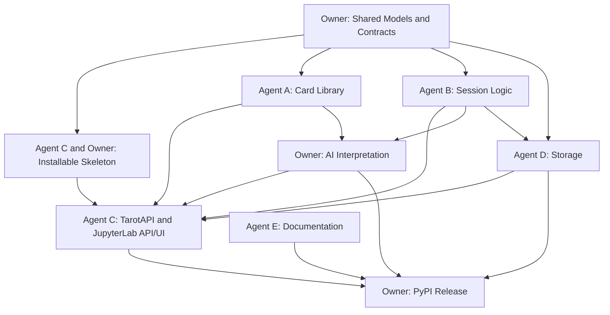

# Tarot JupyterLab Plugin Development Plan

## 项目目标

开发一个运行在 JupyterLab 侧边栏中的塔罗牌插件，支持：

- 浏览和检索 78 张塔罗牌及其背景资料。
- 创建占卜会话、选择牌阵、抽牌和重新抽牌。
- 保存、加载、导入和导出历史记录。
- 调用 AI 生成基于牌面、正逆位和用户问题的解读。
- 通过 JupyterLab 前端侧边栏提供完整交互，并由 Python 后端提供数据和业务 API。
- 前端以英语（`en`）为默认且必须支持的语言；中文和其他界面语言均为可选，不作为首版交付或验收的必要条件。
- 最终打包为可安装的 PyPI Python 包，并提供 JupyterLab 前端扩展。

当前仓库已有：

- `card_set.json`：78 张牌的基础数据。
- `README.md`：牌库字段说明。

当前尚未建立 Python 和 JupyterLab 源代码，因此以下目录为推荐的初始结构。

## 推荐目录结构

```text
project/
├── README.md
├── Plan.md
├── pyproject.toml
├── LICENSE
├── src/
│   └── tarot_jupyterlab/
│       ├── __init__.py
│       ├── _version.py
│       ├── models.py                 # 共享数据模型和类型
│       ├── errors.py                 # 共享异常
│       ├── api.py                    # Agent C：TarotAPI 门面与活动会话协调
│       ├── app.py                    # Jupyter Server extension 入口
│       ├── labextension/             # 仅存放生成的前端预构建产物，不手工编辑
│       ├── static/
│       │   └── card_set.json         # 安装包内置牌库副本
│       ├── card_asset/
│       │   ├── __init__.py
│       │   ├── card_library.py       # 牌库加载、查询和校验
│       │   └── card_lore.py          # 牌面背景资料
│       ├── logic/
│       │   ├── __init__.py
│       │   ├── spreads.py             # 牌阵定义
│       │   └── session.py             # 游戏和会话逻辑
│       ├── jupyter_lab_integration/
│       │   ├── __init__.py
│       │   └── handlers.py            # Jupyter Server API handlers
│       ├── session_history/
│       │   ├── __init__.py
│       │   ├── serialization.py       # SessionRecord 与 JSON 的统一转换、结构校验
│       │   ├── storage.py             # 历史记录持久化
│       │   └── transfer.py            # 导入和导出
│       └── ai/
│           ├── __init__.py
│           ├── provider.py            # AI provider 抽象
│           ├── prompts.py             # Prompt 构建
│           └── interpreter.py         # AI 解读流程
├── frontend/
│   ├── package.json
│   ├── package-lock.json
│   ├── tsconfig.json
│   └── src/
│       ├── index.ts
│       ├── sidebar.ts
│       ├── api.ts
│       ├── types.ts
│       ├── components/
│       │   ├── CardBrowser.tsx
│       │   ├── DrawPanel.tsx
│       │   ├── ReadingPanel.tsx
│       │   └── HistoryPanel.tsx
│       └── style/
│           └── index.css
├── schemas/
│   └── tarot.schema.json             # HTTP、记录文件与导入导出的共享 JSON schema
├── jupyter-config/
│   └── jupyter_server_config.d/
│       └── tarot_jupyterlab.json      # 服务端扩展启用配置
├── tests/
│   ├── unit/
│   ├── integration/
│   ├── contracts/                    # Python/HTTP/前端共用 JSON 样例的契约测试
│   └── fixtures/
└── docs/
    ├── api.md
    ├── development.md
    └── publishing.md
```


## 共享数据模型和接口契约

所有 agent 必须先使用以下模型，不要在各自模块中重复定义相同字段。推荐使用 `dataclasses`、`Enum` 和 `typing`，并在 JSON 边界显式转换。

文件：`src/tarot_jupyterlab/models.py`

```python
from dataclasses import dataclass
from datetime import datetime
from typing import Literal

Arcana = Literal["Major", "Minor"]
Suit = Literal["Wands", "Cups", "Swords", "Pentacles"]
Orientation = Literal["upright", "reversed"]
ReadingLanguage = Literal["zh-CN", "en", "bilingual"]
ExportFormat = Literal["json", "markdown"]


@dataclass(frozen=True)
class Card:
    name: str
    arcana: Arcana
    suit: Suit | None
    number: int | None
    rank: str | None
    element: str
    upright: tuple[str, ...]
    reversed: tuple[str, ...]


@dataclass(frozen=True)
class DrawnCard:
    card: Card
    orientation: Orientation
    position: str


@dataclass
class Session:
    session_id: str
    question: str
    spread_name: str
    cards: list[DrawnCard]
    revision: int
    allow_repeats: bool
    created_at: datetime
    updated_at: datetime


@dataclass(frozen=True)
class Reading:
    session_id: str
    session_revision: int
    summary: str
    card_interpretations: tuple[str, ...]
    advice: str
    provider: str
    created_at: datetime


@dataclass
class SessionRecord:
    session: Session
    reading: Reading | None = None
    schema_version: Literal[1] = 1


@dataclass(frozen=True)
class SessionState:
    record: SessionRecord
    dirty: bool
    reading_in_progress: bool


@dataclass(frozen=True)
class Spread:
    name: str
    positions: tuple[str, ...]


@dataclass(frozen=True)
class SessionSummary:
    session_id: str
    question: str
    spread_name: str
    revision: int
    has_reading: bool
    created_at: datetime
    updated_at: datetime


@dataclass(frozen=True)
class HistoryPage:
    items: tuple[SessionSummary, ...]
    total: int
    limit: int
    offset: int
```

公共函数成功时按声明的签名返回值，失败时抛出 `TarotError` 的子类，不使用未说明的混合返回值。`None` 仅用于明确声明的可选字段或无返回值的校验函数，JSON 转换函数和 health 响应可以返回有固定 schema 的字典。

### 会话、记录和运行状态的边界

- **完整记录**：`SessionRecord` 是保存、加载、JSON 导入及导出的共同单位，必须同时携带 `Session` 和可选 `Reading`。首版每个会话仅保留当前牌面最新一次成功解读，JSON 中没有解读时仍必须包含 `"reading": null`。
- **活动状态**：`SessionState` 用于 HTTP 与前端交互，`dirty`、`reading_in_progress` 由 `TarotAPI` 计算，不写入历史文件，也不接受客户端提供这些值。
- **版本规则**：新会话的 `revision=0`；每次成功抽牌或重抽后增加 1。生成或保存解读不增加牌面版本，失败操作不改变版本；如以后增加问题或牌阵编辑，也必须增加版本并使旧解读失效。
- **关联不变量**：非空 `reading` 的 `session_id` 必须等于所属会话 ID，`session_revision` 必须等于会话当前 `revision`，且所属会话必须已完成整个牌阵。它的逐牌解释数量必须等于已抽牌数量，并按牌阵位置顺序对应；不允许保存或导入违反关联的记录。
- **重复模式**：`allow_repeats` 记录原有可选重复抽牌模式，默认 `False`，创建后不变。将该配置随记录保存，是为了让加载、导入和重抽继续使用同一规则，而不是增加新的抽牌模式。
- **时间规则**：所有时间均为带时区的时间；JSON 使用 ISO 8601 字符串，服务端统一产生 UTC 时间。`updated_at` 在成功抽牌、重抽或接受新解读时更新，单纯查看、保存和加载不改写原时间。
- **快照规则**：门面返回深拷贝或等效隔离快照，调用者不能通过修改返回的可变对象绕过版本校验。共享牌库可复用，但不同活动会话及已保存记录不能共享可变 `cards` 列表。
- **未保存状态**：新建会话 `dirty=True`；保存后为 `False`，恢复历史后为 `False`。之后任何成功改变完整记录的操作都会重新变为 `True`，包括在同一牌面版本下生成新的解读；不能只比较 `revision` 判断是否已保存。

### 契约的维护责任

- **负责人**：维护并审核 `models.py`、`errors.py` 与 schema 的跨模块改动，不改变原有审核职责。
- **Agent C**：实现 `TarotAPI`、HTTP 请求校验和响应适配，维护 `schemas/tarot.schema.json` 及 `frontend/src/types.ts` 的一致性。
- **Agent D**：实现 `serialization.py`，统一记录字段、时间、数组和 `null` 的转换；API、磁盘和导入导出复用该转换，不各写一套序列化。
- **Agent B**：提供 `validate_session` 业务校验入口，由 `TarotAPI` 在导入、加载和状态提交前调用。D 做结构及关联检查，不自行重写抽牌业务规则。
- **共同验收**：schema 使用 `$defs` 复用卡牌、会话和记录定义；JSON 对象拒绝未声明字段。冻结接口前提交同一组合法和非法 fixtures，并让 Python、handler 和前端契约测试消费这些样例。

文件：`src/tarot_jupyterlab/errors.py`

```python
class TarotError(Exception):
    """Base exception for expected application errors."""


class CardNotFoundError(TarotError): ...
class InvalidCardSetError(TarotError): ...
class InvalidSessionError(TarotError): ...
class RecordValidationError(TarotError): ...
class SessionNotFoundError(TarotError): ...
class HistoryNotFoundError(TarotError): ...
class SessionConflictError(TarotError): ...
class SessionRevisionConflictError(SessionConflictError): ...
class ReadingInProgressError(SessionConflictError): ...
class StaleReadingError(SessionConflictError): ...
class DuplicateSessionError(SessionConflictError): ...
class StorageError(TarotError): ...
class AIProviderError(TarotError): ...
class AIUnavailableError(AIProviderError): ...
class AITimeoutError(AIProviderError): ...
```

## Agent A：牌库与背景资料

### 负责范围

- 维护 `card_set.json` 的字段完整性和牌名唯一性。
- 将 JSON 解析为不可变的 `Card` 对象。
- 提供按名称、类别、花色、元素查询牌库的功能。
- 整理大阿卡纳、小阿卡纳、花色、元素、正位和逆位的背景资料。
- 为 AI 模块提供可靠的结构化牌面上下文，不直接负责 AI 生成内容。
- 为前端内置的牌名、牌义关键词和背景资料提供可直接展示的英文内容；中文及其他语言版本可选，不依赖前端临时翻译才能完成英文浏览。

### 主要文件

- `src/tarot_jupyterlab/card_asset/card_library.py`
- `src/tarot_jupyterlab/card_asset/card_lore.py`
- `tests/unit/test_card_library.py`
- `tests/fixtures/invalid_card_set.json`

### 函数接口

```python
from pathlib import Path
from tarot_jupyterlab.models import Arcana, Card, Suit


def load_card_set(path: Path) -> tuple[Card, ...]:
    """Load, parse, validate, and return all cards in stable source order."""


def validate_card_set(cards: list[Card]) -> None:
    """Raise InvalidCardSetError when card count, names, or fields are invalid."""


def get_card(cards: tuple[Card, ...], name: str) -> Card:
    """Return one card by exact name or raise CardNotFoundError."""


def list_cards(
    cards: tuple[Card, ...],
    *,
    arcana: Arcana | None = None,
    suit: Suit | None = None,
    element: str | None = None,
) -> tuple[Card, ...]:
    """Return cards matching all supplied filters."""


def card_keywords(card: Card, orientation: str) -> tuple[str, ...]:
    """Return upright or reversed keywords for a validated orientation."""
```

### 实现要求

- 牌库必须验证总数为 78，Major 为 22，Minor 为 56。
- 牌名必须唯一；Major 的 `suit` 和 `rank` 必须为 `None`。
- Minor 的花色只能是四种标准花色，数字牌和宫廷牌的 `number`、`rank` 组合必须合法。
- `load_card_set` 不应每次请求都读磁盘；由 `api.py` 创建一次牌库实例并复用。
- `card_lore.py` 的背景资料必须是可测试的结构化文本或字典，不要把资料散落在前端组件中。

## Agent B：游戏与会话逻辑

### 负责范围

- 定义单牌、三牌和可扩展自定义牌阵。
- 创建会话、抽牌、记录正逆位和绑定牌阵位置。
- 保证同一个会话不会重复抽到同一张牌，除非明确启用重复抽牌模式。
- 提供可复现的随机种子，便于测试和问题复现。
- 提供统一的会话业务校验，并按共享版本规则更新抽牌和重抽结果。
- 不负责保存文件，也不负责调用 AI。

### 主要文件

- `src/tarot_jupyterlab/logic/spreads.py`
- `src/tarot_jupyterlab/logic/session.py`
- `tests/unit/test_spreads.py`
- `tests/unit/test_session.py`

### 函数接口

```python
from datetime import datetime
from random import Random
from tarot_jupyterlab.models import Card, DrawnCard, Session


def available_spreads() -> tuple[str, ...]:
    """Return registered spread names, such as 'single' and 'three-card'."""


def spread_positions(spread_name: str) -> tuple[str, ...]:
    """Return ordered position names or raise InvalidSessionError."""


def create_session(
    question: str,
    spread_name: str,
    *,
    allow_repeats: bool = False,
    session_id: str | None = None,
    now: datetime | None = None,
) -> Session:
    """Create an empty revision-0 session with a fixed repeat policy."""


def validate_session(
    session: Session, cards: tuple[Card, ...], *, require_complete: bool = False,
) -> None:
    """Validate session rules and optionally require every spread position."""


def draw_cards(
    session: Session,
    cards: tuple[Card, ...],
    *,
    rng: Random | None = None,
    now: datetime | None = None,
) -> Session:
    """Fill unused positions using session.allow_repeats and return revision + 1."""


def redraw_card(
    session: Session,
    position: str,
    cards: tuple[Card, ...],
    *,
    rng: Random | None = None,
    now: datetime | None = None,
) -> Session:
    """Replace one position, preserve other cards, and return revision + 1."""
```

### 实现要求

- `question` 去除首尾空白后不能为空，建议限制最大长度并在 API 层返回清晰错误。
- 牌阵位置顺序必须稳定：单牌阵 `single` 为 `focus`；三牌阵 `three-card` 为 `past`、`present`、`future`。
- 正逆位由 `rng` 产生并记录，不能在前端临时计算。
- 会话对象只表示内存中的业务状态；序列化由 Agent D 负责。
- `allow_repeats` 从原先单次抽牌参数移到创建会话配置，后续抽牌、重抽和导入统一读取 `Session.allow_repeats`，不允许一次调用临时切换模式。
- `validate_session` 检查会话 ID、非负整数版本、时区、牌阵、位置唯一性和顺序、牌面属于已加载牌库，以及所选重复模式下的牌阵合法性。草稿允许尚未填满位置；生成解读时传 `require_complete=True`，加载、导入或保存时则传 `require_complete=(record.reading is not None)`。
- `draw_cards` 和 `redraw_card` 返回更新后的独立 `Session`，不原地修改输入快照；每次成功操作统一增加一个版本。已填满牌阵再次调用抽牌，或重抽不存在/尚未抽取的位置，应失败而不是静默改变状态。
- Agent B 不操作 `Reading`；`TarotAPI` 在接受新的 `Session` 时同步将原记录的 `reading` 清空，确保牌面与解读不会分开更新。
- 每个公共函数都要有边界测试：空牌库、无效牌阵、重复位置、重复抽牌和随机种子。

## Agent C：前端界面及 JupyterLab 集成

### 负责范围

- 注册 JupyterLab sidebar 插件和主菜单命令。
- 实现牌库浏览、牌阵选择、抽牌、重抽、AI 解读、手动保存和历史记录视图。
- 通过 Jupyter Server REST handlers 与 Python 后端通信。
- 在原有后端集成范围内负责 `api.py` 中的 `TarotAPI` 门面，连接 A、B、D 和负责人的 AI 模块，不把业务实现复制到 handler。
- 处理加载、空状态、错误、超时和无 API key 等界面状态。
- 保证插件自身的完整英文界面；是否额外实现中文或其他界面语言由后续范围决定，不要求首版提供语言切换器。
- 不在前端复制抽牌算法、牌库校验或 AI Prompt。

### 主要文件

- `src/tarot_jupyterlab/app.py`
- `src/tarot_jupyterlab/api.py`
- `src/tarot_jupyterlab/jupyter_lab_integration/handlers.py`
- `schemas/tarot.schema.json`
- `jupyter-config/jupyter_server_config.d/tarot_jupyterlab.json`
- `frontend/src/index.ts`
- `frontend/src/sidebar.ts`
- `frontend/src/api.ts`
- `frontend/src/types.ts`
- `frontend/src/components/CardBrowser.tsx`
- `frontend/src/components/DrawPanel.tsx`
- `frontend/src/components/ReadingPanel.tsx`
- `frontend/src/components/HistoryPanel.tsx`
- `tests/integration/test_jupyter_handlers.py`
- `tests/integration/test_tarot_api.py`
- `tests/contracts/`

### TarotAPI 门面契约

`TarotAPI` 由 Agent C 实现，负责人审核共享契约和集成结果，Agent E 仍负责原有文档工作。每个 Jupyter Server 应用实例只创建一个门面实例，统一管理牌库缓存、活动会话、存储目录、provider 和每个会话的并发锁。

```python
from pathlib import Path
from tarot_jupyterlab.ai.provider import AIProvider
from tarot_jupyterlab.models import (
    Arcana, Card, ExportFormat, HistoryPage, ReadingLanguage,
    SessionRecord, SessionState, Spread, Suit,
)


class TarotAPI:
    def __init__(
        self, *, cards: tuple[Card, ...], directory: Path,
        provider: AIProvider | None = None,
        reading_timeout_seconds: float = 60.0,
    ) -> None: ...

    def list_cards(
        self, *, arcana: Arcana | None = None,
        suit: Suit | None = None, element: str | None = None,
    ) -> tuple[Card, ...]: ...

    def get_card(self, name: str) -> Card: ...
    def list_spreads(self) -> tuple[Spread, ...]: ...

    async def create_session(
        self, question: str, spread_name: str, *,
        allow_repeats: bool = False,
    ) -> SessionState: ...

    async def get_session(self, session_id: str) -> SessionState: ...

    async def draw_session(
        self, session_id: str, *, expected_revision: int,
    ) -> SessionState: ...

    async def redraw_session(
        self, session_id: str, position: str, *, expected_revision: int,
    ) -> SessionState: ...

    async def request_reading(
        self, session_id: str, *, expected_revision: int,
        language: ReadingLanguage = "zh-CN",
    ) -> SessionState: ...

    async def save_session(
        self, session_id: str, *, expected_revision: int,
    ) -> SessionState: ...

    async def list_history(
        self, *, limit: int = 20, offset: int = 0,
    ) -> HistoryPage: ...

    async def get_history(self, session_id: str) -> SessionRecord: ...
    async def load_history(self, session_id: str) -> SessionState: ...
    async def import_history(self, payload: str) -> SessionRecord: ...

    async def export_history(
        self, session_id: str, *, format: ExportFormat = "json",
    ) -> str: ...
```

### 活动会话、保存与恢复规则

- **创建**：门面生成 UUID，在活动表中注册完整记录，初始无牌、无解读、版本为 0。创建、抽牌、重抽和解读默认只更新内存，不自动写历史文件。
- **手动保存**：用户点击保存时，门面校验 `expected_revision`，在该会话锁内验证并保存当前完整 `SessionRecord`。首次保存新建文件；对该活动会话已经保存或加载的同 ID 记录，再次保存显式更新该文件。
- **保存成功与失败**：只有磁盘写入成功后才更新已保存快照并返回 `dirty=False`；失败时保留内存变更和原磁盘记录。保存依据完整记录比较，包括解读内容，不能只比较牌面版本。
- **生成中的保存**：有解读请求进行中时，保存返回 `409 READING_IN_PROGRESS`，前端提示等待完成或失败后再保存，避免把等待中的解读误当成已经持久化。
- **历史查看**：`GET /history/{id}` 只返回磁盘快照，不替换活动会话；导出也针对磁盘上最近一次成功保存的快照。若要导出当前未保存内容，UI 应先提示保存，不能悄悄自动保存。
- **恢复编辑**：`POST /history/{id}/load` 校验记录后恢复为同 ID、同版本的活动会话，包含已有解读并返回 `dirty=False`。若相同 ID 已在活动表中且记录完全相同、无进行中的请求，直接返回该状态；否则返回 `409 ACTIVE_SESSION_CONFLICT`，绝不覆盖未保存内容或替换正在生成的实例。
- **JSON 导入**：导入完整记录，依次做 schema、记录关联和 B 的业务校验，成功后作为历史文件保存，但不自动替换当前活动会话。ID 若已存在于磁盘或活动表，返回 `409 DUPLICATE_SESSION_ID`；首版不静默覆盖或自动重命名。
- **生命周期**：活动会话由门面按 ID 管理，首版不自动淘汰；服务重启后活动表清空，未保存内容不恢复。浏览器刷新后可以凭当前 ID 查询活动状态；若已不存在，应引导用户从历史加载或新建，而不是自动写入旧页面缓存。
- **封装**：handler 只负责 HTTP/schema 与门面调用；B 负责会话变换，D 负责转换和文件操作，AI 只返回候选解读。所有状态提交与按 ID 的并发检查都留在门面。

### 重抽与迟到 AI 响应规则

同一会话的状态变更必须经同一把锁串行提交，AI 网络等待期间不能一直持锁。下列流程是实现要求，不是仅靠前端禁用按钮的提示性约定。

1. 请求生成时，锁内检查活动会话存在、`expected_revision` 匹配、牌阵完整、问题有效且没有其他生成请求。
2. 深拷贝会话快照，并记录服务端生成的唯一请求 token、会话 ID 和版本；设置 `reading_in_progress=True` 后释放锁。
3. 仅用该快照调用 AI；现有同步 `generate_reading` 经工作线程运行，不能直接在 handler 的事件循环中做阻塞调用。工作线程不得访问活动表或保存历史。
4. 生成期间允许重抽；门面接受重抽结果时增加版本并立即清空旧解读，但在旧请求结束前仍保持“有请求进行中”，不启动同会话第二个请求。
5. AI 返回后重新加锁，检查请求 token 仍有效且会话仍处于请求时的版本；不匹配则丢弃结果并返回 `409 STALE_READING`，不能覆盖当前记录。
6. 只有匹配时才接受经过验证的 `Reading`，更新 `updated_at` 和未保存状态；此前同版本的旧解读仅在新结果成功后被替换。
7. 成功、失败、超时及取消路径均须释放当前 token 对应的进行中标记。超时会撤销 token；即使同步工作线程稍后才结束，也不能再提交结果，旧请求的清理也不能误清除新的 token。

前端同样检查响应所属会话、版本和本地请求标记；重抽或切换会话后，旧响应不得覆盖当前页面。收到版本冲突时先重新获取状态并提示用户，不自动重试会改变牌面或重新调用 AI 的操作。

### 后端函数接口

```python
from typing import Any
from tarot_jupyterlab.api import TarotAPI


def add_handlers(web_app: Any, api: TarotAPI) -> None:
    """Register handlers under the server base_url followed by tarot/api/."""


def health_check() -> dict[str, str]:
    """Return a small readiness response, for example {'status': 'ok'}."""
```

### HTTP API 契约

下表使用相对于 Jupyter Server `base_url` 的逻辑路径；前后端均须从服务配置拼接前缀，不能把根路径硬编码到组件。JupyterLab 官方请求模式通过服务器设置的 `baseUrl` 和 `ServerConnection.makeRequest` 发起请求，本计划沿用该方式（[JupyterLab 请求设计模式](https://jupyterlab.readthedocs.io/en/4.6.x/developer/patterns.html)）。

| Method | Path | Request | 成功状态与 Response |
| --- | --- | --- | --- |
| `GET` | `/tarot/api/health` | 无 | `200 HealthJSON`，无 AI 配置也应可用 |
| `GET` | `/tarot/api/cards` | `CardFilters` 查询参数 | `200 CardJSON[]` |
| `GET` | `/tarot/api/cards/{name}` | URL 编码的牌名 | `200 CardJSON` |
| `GET` | `/tarot/api/spreads` | 无 | `200 SpreadJSON[]` |
| `POST` | `/tarot/api/sessions` | `CreateSessionRequest` | `201 SessionStateJSON` |
| `GET` | `/tarot/api/sessions/{id}` | 无 | `200 SessionStateJSON`，不存在则 404 |
| `POST` | `/tarot/api/sessions/{id}/draw` | `DrawRequest` | `200 SessionStateJSON` |
| `POST` | `/tarot/api/sessions/{id}/redraw` | `RedrawRequest` | `200 SessionStateJSON` |
| `POST` | `/tarot/api/sessions/{id}/reading` | `ReadingRequest` | `200 SessionStateJSON`，含已接受的解读 |
| `POST` | `/tarot/api/sessions/{id}/save` | `SaveSessionRequest` | `200 SessionStateJSON`，`dirty=False` |
| `GET` | `/tarot/api/history` | `HistoryQuery` 查询参数 | `200 HistoryPageJSON` |
| `GET` | `/tarot/api/history/{id}` | 无 | `200 SessionRecordJSON`，不存在则 404 |
| `POST` | `/tarot/api/history/{id}/load` | 空对象 `{}` | `200 SessionStateJSON` |
| `POST` | `/tarot/api/history/import` | `SessionRecordJSON` | `201 SessionRecordJSON` |
| `GET` | `/tarot/api/history/{id}/export` | `format=json\|markdown`，默认 json | `200` 文件下载 |

所有 JSON 写请求使用 `application/json`；用户选取 JSON 文件时，由前端读取并发送其 JSON 内容，不额外引入 multipart 上传协议。文件下载返回适当的 MIME 类型和 `Content-Disposition`，Markdown 导出不作为 JSON 导入的输入。

### HTTP 数据类型和字段约定

以下是 `frontend/src/types.ts` 的契约草案，与 Python 模型及 `schemas/tarot.schema.json` 保持对应。TypeScript 的 `number` 字段中，`revision`、`session_revision`、分页值和牌号必须由 JSON schema 校验为整数；版本和 offset 不得为负。

```typescript
export type Arcana = "Major" | "Minor";
export type Suit = "Wands" | "Cups" | "Swords" | "Pentacles";
export type Orientation = "upright" | "reversed";
export type ReadingLanguage = "zh-CN" | "en" | "bilingual";
export type ExportFormat = "json" | "markdown";

export interface CardJSON {
  name: string;
  arcana: Arcana;
  suit: Suit | null;
  number: number | null;
  rank: string | null;
  element: string;
  upright: string[];
  reversed: string[];
}

export interface DrawnCardJSON {
  card: CardJSON;
  orientation: Orientation;
  position: string;
}

export interface SessionJSON {
  session_id: string;
  question: string;
  spread_name: string;
  cards: DrawnCardJSON[];
  revision: number;
  allow_repeats: boolean;
  created_at: string;
  updated_at: string;
}

export interface ReadingJSON {
  session_id: string;
  session_revision: number;
  summary: string;
  card_interpretations: string[];
  advice: string;
  provider: string;
  created_at: string;
}

export interface SessionRecordJSON {
  schema_version: 1;
  session: SessionJSON;
  reading: ReadingJSON | null;
}

export interface SessionStateJSON {
  record: SessionRecordJSON;
  dirty: boolean;
  reading_in_progress: boolean;
}

export interface SpreadJSON {
  name: string;
  positions: string[];
}

export interface SessionSummaryJSON {
  session_id: string;
  question: string;
  spread_name: string;
  revision: number;
  has_reading: boolean;
  created_at: string;
  updated_at: string;
}

export interface HistoryPageJSON {
  items: SessionSummaryJSON[];
  total: number;
  limit: number;
  offset: number;
}

export interface HealthJSON {
  status: "ok";
}

export interface CardFilters {
  arcana?: Arcana;
  suit?: Suit;
  element?: string;
}

export interface CreateSessionRequest {
  question: string;
  spread_name: string;
  allow_repeats?: boolean;
}

export interface DrawRequest {
  expected_revision: number;
}

export interface RedrawRequest {
  expected_revision: number;
  position: string;
}

export interface ReadingRequest {
  expected_revision: number;
  language?: ReadingLanguage;
}

export interface SaveSessionRequest {
  expected_revision: number;
}

export interface HistoryQuery {
  limit?: number;
  offset?: number;
}

export interface ErrorJSON {
  error: {
    code: string;
    message: string;
    details?: Record<string, unknown>;
  };
}
```

- **默认值**：`allow_repeats=False`、`limit=20`、`offset=0`；`limit` 范围为 1 至 100，列表按 `updated_at` 降序并以 `session_id` 作稳定次序，`total` 为符合条件的有效已保存记录总数。
- **语言边界**：前端界面默认 `en`，默认生成请求显式发送 `language="en"`。`ReadingRequest.language` 只控制 AI 解读正文，不是界面语言；后端接口在省略该字段时仍保留原有的 `zh-CN` 默认值，不影响英文前端的显式请求。
- **字段验证**：问题去首尾空白后长度为 1 至 2000 个 Unicode 字符；会话 ID 为 UUID 字符串，位置来自所选牌阵。请求里的版本仅用于比较，客户端不能指定下一个版本、解读关联字段或时间。
- **成功响应**：活动会话端点统一返回 `SessionStateJSON`，历史详情及导入返回 `SessionRecordJSON`；不再有丢弃 `reading` 的历史详情响应。
- **JSON 等价**：Python 的 tuple/list 在 JSON 中均为数组；时间保留时区，`None` 转为 `null`。保存、加载、导出和导入后的数据语义须一致。

### 错误映射

本插件产生的业务错误统一返回 `ErrorJSON`，前端根据稳定的 `code` 显示用户可读的英文消息；API 的默认 `message` 也使用英语，中文及其他翻译可选。Jupyter 自身的认证失败由其安全机制处理，前端也须能识别非业务格式的 401/403，并显示英文兜底提示，而不是假设所有错误都能解析为本插件 JSON。

| HTTP 状态 | 场景或异常 | `error.code` |
| --- | --- | --- |
| 400 | JSON 语法错误或不支持的导出格式 | `INVALID_JSON` / `INVALID_FORMAT` |
| 404 | `CardNotFoundError` / `SessionNotFoundError` / `HistoryNotFoundError` | `CARD_NOT_FOUND` / `SESSION_NOT_FOUND` / `HISTORY_NOT_FOUND` |
| 409 | `SessionRevisionConflictError` | `REVISION_CONFLICT` |
| 409 | `ReadingInProgressError` / `StaleReadingError` | `READING_IN_PROGRESS` / `STALE_READING` |
| 409 | `DuplicateSessionError` | `DUPLICATE_SESSION_ID` |
| 409 | `SessionConflictError`，活动会话恢复冲突或牌阵已抽满 | `ACTIVE_SESSION_CONFLICT` / `SESSION_ALREADY_DRAWN` |
| 422 | `InvalidSessionError` / `RecordValidationError` 或 schema 校验失败 | `INVALID_SESSION` / `INVALID_RECORD` / `INVALID_REQUEST` |
| 503 | `AIUnavailableError`，未配置 provider | `AI_NOT_CONFIGURED` |
| 504 | `AITimeoutError` | `AI_TIMEOUT` |
| 502 | 其他预期 `AIProviderError` | `AI_PROVIDER_ERROR` |
| 500 | `StorageError` 或未预期错误 | `STORAGE_ERROR` / `INTERNAL_ERROR` |

例如版本冲突可在 `details` 中返回当前版本，便于前端刷新状态。错误正文不包含 API key、用户完整问题、内部堆栈或本地绝对路径。

```json
{
  "error": {
    "code": "REVISION_CONFLICT",
    "message": "The session has changed. Refresh and try again.",
    "details": {"expected_revision": 1, "current_revision": 2}
  }
}
```

### 前端函数接口

```typescript
import type {
  CardFilters, CardJSON, CreateSessionRequest, DrawRequest, ExportFormat,
  HealthJSON, HistoryPageJSON, HistoryQuery, ReadingRequest, RedrawRequest,
  SaveSessionRequest, SessionRecordJSON, SessionStateJSON, SpreadJSON,
} from "./types";

export declare function fetchHealth(): Promise<HealthJSON>;
export declare function fetchCards(filters?: CardFilters): Promise<CardJSON[]>;
export declare function fetchCard(name: string): Promise<CardJSON>;
export declare function fetchSpreads(): Promise<SpreadJSON[]>;
export declare function createSession(request: CreateSessionRequest): Promise<SessionStateJSON>;
export declare function fetchSession(id: string): Promise<SessionStateJSON>;
export declare function drawSession(id: string, request: DrawRequest): Promise<SessionStateJSON>;
export declare function redrawSession(id: string, request: RedrawRequest): Promise<SessionStateJSON>;
export declare function requestReading(id: string, request: ReadingRequest): Promise<SessionStateJSON>;
export declare function saveSession(id: string, request: SaveSessionRequest): Promise<SessionStateJSON>;
export declare function fetchHistory(query?: HistoryQuery): Promise<HistoryPageJSON>;
export declare function fetchHistoryRecord(id: string): Promise<SessionRecordJSON>;
export declare function loadHistoryRecord(id: string): Promise<SessionStateJSON>;
export declare function importHistoryRecord(record: SessionRecordJSON): Promise<SessionRecordJSON>;
export declare function exportHistoryRecord(id: string, format?: ExportFormat): Promise<Blob>;
```

### 前端语言要求

- **英语必选**：插件自身的标题、菜单、按钮、表单标签、占位文字、帮助说明、牌阵位置、正逆位标签、加载和空状态、成功提示、错误提示以及无障碍标签，都必须有完整英文文案，不能只有导航或部分按钮是英文。
- **英语默认**：首次使用默认显示英语；即使浏览器或 JupyterLab 宿主界面采用其他语言，插件仍须能完整运行于英语，不因缺少对应翻译而显示空白、内部文案键名或中文兜底。
- **其他语言可选**：中文及其他界面语言不属于首版必做项，也不影响首版验收。若后续增加可选翻译，缺失条目回退英语；首版可仅维护一套集中管理的英文文案，不强制引入多语言框架。
- **界面与内容分离**：内置产品说明和牌面资料须可用英语浏览；用户输入、导入的历史内容及已保存解读保留原文，不因界面为英语而被静默翻译或改写。计划文档自身的编写语言不属于前端语言要求。
- **AI 请求语言**：英文界面默认请求 `language="en"`，不能依赖后端省略参数时的中文默认值。AI 解读语言选项与界面语言独立，保留既有后端能力不意味着必须开发中文界面。

### 实现要求

- `index.ts` 导出标准 JupyterLab `JupyterFrontEndPlugin<void>`。
- `sidebar.ts` 使用 `MainAreaWidget` 或 `ReactWidget` 挂载单一侧边栏入口，避免重复注册。
- 所有网络请求统一经过 `api.ts`，组件不直接拼接 URL。
- API 错误必须转换为用户可读的英文提示；中文及其他翻译可选，未知错误也必须提供英文兜底文案。
- UI 只展示后端返回的 `DrawnCard.orientation`，不自行决定正位或逆位。
- UI 明确显示 `Unsaved changes`、`Saved`、`Generating reading...` 等英文状态；重抽成功后立即移除旧解读，发生存储错误时不能显示保存成功。
- 历史界面区分只读查看和恢复编辑，并提示导出的是最近一次已保存版本。导入、加载、保存按钮应通过上述统一接口工作，不另外拼接数据格式。
- C 负责前端产物和服务端入口，负责人负责构建配置审核及最终发布，E 同步安装文档；不将 E 改成集成开发角色。

## Agent D：历史记录存储与数据导入导出

### 负责范围

- 以 `SessionRecord` 为单位完整保存和读取 `Session` 与 `Reading`，不提供会静默丢弃解读的替代路径。
- 设计版本化 JSON 存储格式，支持未来字段升级。
- 提供 JSON 和 Markdown 导出，以及 JSON 导入。
- 处理文件权限、损坏文件、重复 session ID 和路径安全问题。
- 不负责会话业务规则；加载及导入的记录经结构和关联检查后，必须由 `TarotAPI` 交给 Agent B 验证，才能进入活动表或完成导入写入。

### 主要文件

- `src/tarot_jupyterlab/session_history/storage.py`
- `src/tarot_jupyterlab/session_history/transfer.py`
- `src/tarot_jupyterlab/session_history/serialization.py`
- `tests/unit/test_storage.py`
- `tests/unit/test_transfer.py`

### 函数接口

```python
from pathlib import Path
from typing import Any, Literal
from tarot_jupyterlab.models import ExportFormat, SessionRecord


def validate_record(record: SessionRecord) -> None:
    """Check record structure, supported version, times, and reading linkage."""


def record_to_dict(record: SessionRecord) -> dict[str, Any]:
    """Return the canonical SessionRecordJSON shape, including reading or null."""


def record_from_dict(payload: dict[str, Any]) -> SessionRecord:
    """Parse and validate structure/linkage without writing files."""


def default_storage_dir() -> Path:
    """Return the platform-appropriate per-user storage directory."""


def save_record(
    record: SessionRecord, directory: Path, *, overwrite: bool = False,
) -> Path:
    """Atomically write a complete record; reject an existing ID unless explicit."""


def load_record(session_id: str, directory: Path) -> SessionRecord:
    """Load a complete, structurally valid record; distinguish missing from corrupt."""


def list_records(directory: Path) -> tuple[SessionRecord, ...]:
    """Return valid records in the API's stable history order."""


def export_record(record: SessionRecord, format: ExportFormat) -> str:
    """Export the complete record as JSON, or render a Markdown reading report."""


def import_record(
    payload: str, *, format: Literal["json"] = "json",
) -> SessionRecord:
    """Parse and structurally validate a complete record without persisting it."""
```

### 存储格式要求

- 顶层固定包含 `schema_version`、`session`、`reading`；`schema_version=1`，`reading` 无值时为 `null`。`SessionState` 的运行标记不得混入文件。
- 时间统一使用 ISO 8601 字符串并带时区信息。
- 写文件使用临时文件加原子替换，避免 JupyterLab 中断时产生半个 JSON。
- 所有应用内写操作由 `TarotAPI` 按会话串行执行；`overwrite=True` 仅用于用户显式保存该活动会话的更新，导入始终使用 `overwrite=False`。
- 导入只接受预期字段，拒绝路径穿越、未知版本、不完整牌面、错误的解读会话 ID 或版本。校验完成前不创建或覆盖目标历史文件。
- `import_record` 只解析，不写盘；门面随后调用 B 的业务校验、检查磁盘及活动表 ID 冲突，再调用 `save_record`。加载过程同样必须经业务校验后才能恢复编辑。
- 缺失记录抛 `HistoryNotFoundError`；损坏的已保存文件抛 `StorageError`。列表可跳过损坏文件并记录不含用户问题的诊断，但不能修改或删除原文件。
- Markdown 导出应包含问题、牌阵、每张牌的牌名、位置、正逆位、关键词和 AI 解读。
- 保存和加载不得重算随机结果、重新调用 AI 或改变原时间；JSON 导出再导入必须保留完整记录。往返测试应在另一个空目录导入，同目录重复导入则应验证 409 冲突规则。

### 完整记录 JSON 示例

以下卡牌和解读文本仅作为结构示例，不取代项目实际牌库；正式契约 fixture 应从 `card_set.json` 取对应牌面。示例展示版本为 1 的单牌会话及其同版本解读，`SessionStateJSON` 只需在该记录外包装运行状态。

```json
{
  "schema_version": 1,
  "session": {
    "session_id": "5af02746-6e0b-4689-a61f-52d765d98831",
    "question": "今天我可以关注什么？",
    "spread_name": "single",
    "cards": [
      {
        "card": {
          "name": "The Fool",
          "arcana": "Major",
          "suit": null,
          "number": 0,
          "rank": null,
          "element": "Air",
          "upright": ["示例正位关键词"],
          "reversed": ["示例逆位关键词"]
        },
        "orientation": "upright",
        "position": "focus"
      }
    ],
    "revision": 1,
    "allow_repeats": false,
    "created_at": "2026-10-28T10:00:00+00:00",
    "updated_at": "2026-10-28T10:00:10+00:00"
  },
  "reading": {
    "session_id": "5af02746-6e0b-4689-a61f-52d765d98831",
    "session_revision": 1,
    "summary": "仅用于契约测试的示例摘要。",
    "card_interpretations": ["与 focus 位置对应的示例解读。"],
    "advice": "仅用于展示数据结构，不是实际解读。",
    "provider": "FakeAIProvider",
    "created_at": "2026-10-28T10:00:10+00:00"
  }
}
```

## Agent E：PyPI 包文档

### 负责范围

- 编写安装、配置、开发、测试和发布文档。
- 说明 JupyterLab 版本兼容性、Python 版本、AI provider 配置和隐私注意事项。
- 为所有公开 Python 函数补充 docstring 和最小使用示例。
- 维护变更日志、版本号说明和故障排除章节。

### 主要文件

- `README.md`
- `docs/development.md`
- `docs/api.md`
- `docs/publishing.md`
- `CHANGELOG.md`
- `pyproject.toml` 中的项目描述和依赖元数据

### 文档验收要求

- 新用户可以仅依靠 README 完成安装、启动 JupyterLab 和创建第一次占卜。
- 开发者可以根据 `docs/development.md` 运行测试和构建前端。
- `docs/api.md` 的参数、返回类型、错误类型必须与实际实现一致。
- 文档明确说明前端英语为默认且必选，其他界面语言可选，并区分界面语言与 `ReadingRequest.language` 控制的 AI 解读语言。
- 明确说明 AI 请求可能发送哪些内容，默认不发送历史记录之外的敏感信息。
- PyPI 页面不得写入 API key、测试用户数据或本地绝对路径。

## 负责人：代码审核、AI 功能和最终发布

### AI 模块职责

主要文件：`src/tarot_jupyterlab/ai/provider.py`、`prompts.py`、`interpreter.py`。

```python
from typing import Protocol
from tarot_jupyterlab.models import Reading, ReadingLanguage, Session


class AIProvider(Protocol):
    def generate(self, prompt: str) -> str:
        """Return model output for one prompt."""


def build_reading_prompt(
    session: Session, *, language: ReadingLanguage = "zh-CN",
) -> str:
    """Build a bounded prompt from the question and drawn cards."""


def generate_reading(
    session: Session,
    provider: AIProvider,
    *,
    language: ReadingLanguage = "zh-CN",
) -> Reading:
    """Return a validated reading bound to the supplied session snapshot."""
```

AI 实现要求：

- AI 只解释已抽出的牌，不拥有抽牌、随机数或历史记录写入权限。
- Prompt 必须区分用户问题、牌面事实、正逆位关键词和输出格式要求。
- 对模型输出设置长度限制，处理超时、空响应、provider 错误和不可解析响应。
- AI 解读语言保留原有后端约定：省略参数时默认中文，也可请求英文或中英双语。英文前端默认显式请求英文解读，界面中的“仅供娱乐和自我反思”声明必须提供英文版本；这不要求开发中文界面。
- 不把 API key 提交到 Git、JSON 历史记录、前端日志或 PyPI 包。
- 提供一个 `FakeAIProvider` 用于测试，避免单元测试调用真实模型。
- 展示所用的AI模型将使用CS1302A课程所提供的`Socrates`模型。
- `generate_reading` 仅消费门面传入的隔离快照，不接收活动表或存储对象；返回的 `session_id` 和 `session_revision` 由程序从快照填写，不能相信模型自行生成的关联字段。
- 模型正文解析为 `summary`、按牌阵位置排序的 `card_interpretations` 和 `advice`；校验非空内容和逐牌解释数量，provider 名称由适配器填写。
- 同步 provider 接口保持不变，由 `TarotAPI` 放入工作线程并设置整体等待超时；若以后采用异步 provider，仍必须遵守相同的快照和 token 提交规则。
- `FakeAIProvider` 必须支持受控的延迟、失败和迟到返回，用来测试“开始生成 → 重抽 → 旧结果返回”以及“超时 → 新请求 → 旧结果迟到”两类竞态。

### 代码审核职责

每个 agent 提交前必须提供：

1. 变更说明和影响范围。
2. 新增或修改函数的参数、返回类型和异常说明。
3. 单元测试或集成测试，以及本地运行命令。
4. 是否改变 API、JSON schema、依赖或数据隐私边界。

审核重点：

- 数据模型是否只有一份真实定义，模块之间是否使用共享模型。
- 抽牌随机性、重复牌规则和随机种子是否可测试。
- API 输入是否验证，错误是否转换为稳定的 HTTP 状态码。
- 导入数据是否经过 schema、版本和路径安全校验。
- AI 是否只能读取必要上下文，是否可能泄露 API key 或用户数据。
- JupyterLab 扩展是否能在无 AI 配置时正常启动和浏览牌库。
- 是否包含类型检查、Lint、测试和构建结果。
- 是否能完整保存、加载和导入导出同一份 `SessionRecord`，且活动接口不遗漏当前解读。
- 是否在重抽和接受解读时校验会话版本，并在所有错误路径清理请求状态。

## 协作顺序和依赖关系



箭头表示集成所需的前置交付，不表示所有模块必须顺序开发。核心业务实现可以对 fixtures 和替身并行推进，但安装验证不能等到所有业务完成后才开始。

### 首个里程碑：契约与可安装骨架

1. 负责人冻结共享模型、记录关联规则和错误代码；C 与 D 一起提交 JSON schema、请求/响应样例和往返 fixture。
2. C 建立空侧栏、`health` handler 和 `TarotAPI` 的最小实例，暂不依赖真实 AI；负责人配置构建流程，E 记录实际可复现的安装命令。
3. 构建 wheel，在干净环境安装后同时检查前端发现、服务端启用和 health 请求。必须能从侧栏读取 `{"status":"ok"}`，不能用开发模式软链接成功代替安装成功。
4. 在认证开启及非根 `base_url` 下重复最小通信验证，确认 API 前缀与认证处理正确；不得关闭保护来使测试通过。

### 并行实现与完整闭环

1. A 完成牌库加载和校验；B 对固定 fixture 完成会话逻辑、版本变化和业务验证。
2. D 完成完整记录转换、持久化、导入导出及异常测试；C 对假数据实现 UI，并持续将模块接入门面。
3. 负责人实现 AI provider、Prompt 和快照解读测试，首先接通 `FakeAIProvider`，再接入课程提供的 Socrates。
4. 验证“创建 → 抽牌 → 解读 → 手动保存 → 服务重启 → 加载 → JSON 导出/导入”，确认解读与牌面均不丢失。
5. 验证重抽和迟到结果、重复点击、版本冲突及保存失败；E 同步文档，负责人进行集成审核和发布。

### 构建和扩展发现约定

本项目沿用原定的 Python 后端与 JupyterLab 前端路线，明确使用预构建前端产物分发。JupyterLab 官方说明了 `jupyterlab.outputDir`、前端产物的安装位置及官方扩展模板，本项目按该机制建立构建配置（[JupyterLab 扩展开发文档](https://jupyterlab.readthedocs.io/en/4.6.x/extension/extension_dev.html)）。

- **前端源码**：仅在 `frontend/src/` 维护，`package.json` 声明扩展入口，并设置 `jupyterlab.outputDir` 为 `../src/tarot_jupyterlab/labextension`。
- **构建脚本**：C 在 `frontend/package.json` 定义 `build`、`typecheck`、`lint`、`test`；`build` 必须完成 TypeScript 编译及 JupyterLab 预构建打包，不能只执行 `tsc`。前端依赖通过提交的 `package-lock.json` 和 `npm ci` 安装。
- **Python 打包**：负责人基于官方模板配置 `pyproject.toml` 的构建 hook，使 `python -m build` 能从干净源码构建前端并包含产物；缺失或过期的必需产物必须使构建失败，不能发布一个只有后端的包。
- **安装映射**：wheel 将生成的前端目录安装到 `<sys-prefix>/share/jupyter/labextensions/<package.json.name>`，将服务端启用 JSON 安装到 `<sys-prefix>/etc/jupyter/jupyter_server_config.d/`。构建时将唯一的 schema 源文件 `schemas/tarot.schema.json` 映射为包资源 `tarot_jupyterlab/schemas/tarot.schema.json`，运行时从安装包读取，不能依赖当前工作目录；路径与配置键须通过干净环境实际核验。
- **源码包**：sdist 必须包含从源码重新构建 wheel 所需的 Python 源码、牌库、前端源码、锁文件、schema 和启用配置；只包含开发机器上的现成产物不算完整验证。
- **开发与用户环境**：开发/源码构建环境准备前端工具链；从已构建 wheel 安装的终端用户不应需要手工运行前端构建，这也符合预构建扩展的安装机制（[JupyterLab 预构建扩展说明](https://jupyterlab.readthedocs.io/en/4.6.x/extension/extension_dev.html)）。
- **版本记录**：C 与负责人在首个安装里程碑记录实际通过的 Python、JupyterLab、Jupyter Server 和构建工具版本，并同步依赖范围；未验证的版本不能写成已支持。

服务端通过包根部 `_jupyter_server_extension_points()` 指向 `tarot_jupyterlab.app`，由该模块的 `_load_jupyter_server_extension(serverapp)` 创建门面并注册 handlers；这是独立于前端发现的加载步骤（[Jupyter Server 扩展文档](https://jupyter-server.readthedocs.io/en/latest/developers/extensions.html)）。启用配置由 C 提供，负责人审核其打包映射，并用实际安装验证而不是文件名推断加载成功。

```json
{
  "ServerApp": {
    "jpserver_extensions": {
      "tarot_jupyterlab": true
    }
  }
}
```

## 分支、提交和合并约定

- 分支命名：`agent-a-card-library`、`agent-b-session`、`agent-c-jupyterlab`、`agent-d-storage`、`agent-e-docs`。
- 每个提交只处理一个领域，提交信息使用动词开头，例如 `Add card library validation`。
- agent 不直接修改其他 agent 的核心目录；跨边界需求先更新接口契约。
- 合并请求必须通过格式化、Lint、类型检查、单元测试和相关集成测试。
- 任何修改 `models.py`、API 路径、JSON schema 或 `pyproject.toml` 的提交必须由负责人审核。

## 测试和质量门槛

推荐工具：`pytest`、`pytest-asyncio`、`mypy` 或 `pyright`、`ruff`、JupyterLab build tooling。

最低检查命令：

```bash
python -m pytest
python -m ruff check .
python -m ruff format --check .
python -m pyright
npm ci --prefix frontend
npm --prefix frontend run typecheck
npm --prefix frontend run lint
npm --prefix frontend run test
npm --prefix frontend run build
python -m build
```

必须覆盖：

- 78 张牌加载、字段验证和查询过滤。
- 单牌阵和三牌阵的抽牌、正逆位、重复牌和固定随机种子。
- 完整 `SessionRecord` 的 JSON 保存、加载、schema 版本处理、损坏文件和导入导出，不丢失解读。
- API 的成功、400、404、409、422、500、502、503 和 504 场景，以及 Jupyter 认证失败的界面处理。
- JupyterLab 侧边栏启动、空状态、后端断开和 AI 未配置场景。
- 英文界面贯穿牌库浏览、创建、抽牌、重抽、解读、保存、历史及导入导出；覆盖英文错误、确认信息、空状态和无障碍标签，不能靠中文界面完成任何必需操作。
- 默认前端解读请求包含 `language="en"`；界面语言不改变历史原文，也不把已保存的非英文解读自动翻译为英语。
- 在非英语浏览器或 JupyterLab 宿主环境中，插件仍能使用完整英文界面；可选翻译缺失时回退英语，未实现中文界面不得判为首版验收失败。
- AI provider 的成功、超时、空输出和错误响应。
- 单牌阵的位置固定为 `focus`；三牌阵固定为 `past`、`present`、`future`，Python、schema 样例和前端显示保持一致。
- 创建、抽牌、重抽、生成解读、手动保存的版本变化和 `dirty` 状态，包括同版本生成新解读后仍需重新保存。
- 服务重启后恢复牌面及解读，恢复编辑冲突不覆盖未保存状态，重复导入不覆盖现有历史。
- 在生成期间重抽，旧结果返回后被拒绝；超时后开启新请求，旧线程的迟到结果或清理不覆盖新请求。
- 保存失败、AI 错误、非法导入和版本冲突均不部分写入记录或使运行状态永久卡在 `Generating reading...`。
- 同一组 JSON fixtures 经过 Python 转换、HTTP 返回和前端解析仍保持同样字段，覆盖 `null`、数组、时间及非法关联。
- 干净环境安装 wheel 后，前端、服务端、静态资源和 API 都可用；另外从 sdist 构建 wheel，确认必需输入没有遗漏。

建议新增 `test_record_roundtrip.py`、`test_reading_race.py` 和 `test_install_smoke` 对应测试，测试具体技术形式由各模块负责人选择。验收不能以单元测试替代真实安装，也不能以真实 AI 偶然成功代替可重复的竞态测试。

## PyPI 发布清单

由负责人最终执行：

1. 确认版本号、`pyproject.toml` 元数据、许可证和 README 内容。
2. 确认 wheel 包含牌库、schema、前端预构建产物和服务端启用配置；确认 sdist 包含重新构建所需输入。
3. 重复首个里程碑的干净环境安装验证，检查 `jupyter labextension list`、`jupyter server extension list`、侧栏和 health API，并从 sdist 重建 wheel 验证。
4. 运行全部测试、Lint、类型检查和前端构建。
5. 使用 TestPyPI 验证安装、JupyterLab 扩展发现和侧边栏加载。
6. 检查 wheel 内容，不包含 API key、缓存、历史数据和本地路径。
7. 发布到 PyPI，创建 Git tag，并更新 `CHANGELOG.md`。
8. 在全新环境中从 PyPI 安装并完成一次手工冒烟测试，走通创建、抽牌、解读、手动保存、重启加载与导出。

## Definition of Done

项目达到第一版发布标准的条件：

- 用户可以从 PyPI 安装插件，并在 JupyterLab 侧边栏打开。
- 插件默认提供完整英文界面，全部必需操作、系统提示和无障碍标签均可用英语完成；中文及其他界面语言可不实现，不作为发布阻塞项。
- 用户可以浏览牌库、创建会话、选择牌阵、抽牌、按位置重抽并看到正逆位。
- 用户可以生成 AI 解读，也可以在未配置 AI 时使用非 AI 功能。
- 用户可以手动保存、加载、导入和导出完整历史记录，服务重启和 JSON 往返均保留会话与解读。
- 重抽立即使旧解读失效，任何旧版本或已失效请求的 AI 结果都不能覆盖当前牌面。
- `TarotAPI`、请求/响应 schema、运行状态及错误映射已经实现并经过契约测试，前端不使用自行猜测的数据结构。
- 空侧栏到后端 API 的安装验证在第一个里程碑通过，并在最终构建产物上重复通过。
- 所有公开接口有类型标注、docstring 和测试。
- 文档中的函数签名、API 路径、依赖和安装步骤与实际代码一致。
- 完整测试和构建在干净环境中通过，且发布包不包含敏感信息。
