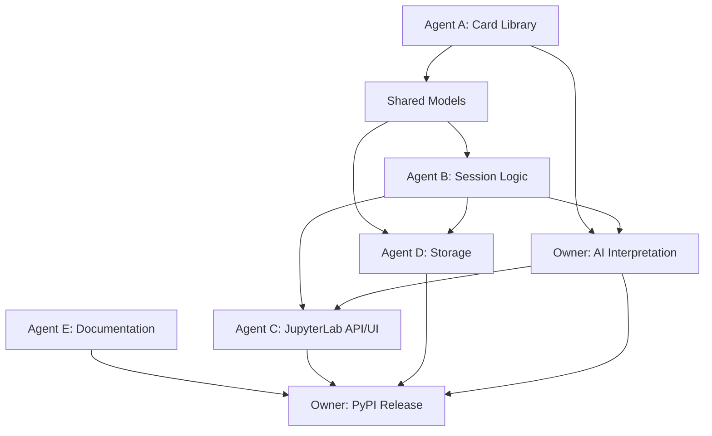

# Tarot JupyterLab Plugin Development Plan

## 1. 项目目标

开发一个运行在 JupyterLab 侧边栏中的塔罗牌插件，支持：

- 浏览和检索 78 张塔罗牌及其背景资料。
- 创建占卜会话、选择牌阵、抽牌和重新抽牌。
- 保存、加载、导入和导出历史记录。
- 调用 AI 生成基于牌面、正逆位和用户问题的解读。
- 通过 JupyterLab 前端侧边栏提供完整交互，并由 Python 后端提供数据和业务 API。
- 最终打包为可安装的 PyPI Python 包，并提供 JupyterLab 前端扩展。

当前仓库已有：

- `card_set.json`：78 张牌的基础数据。
- `README.md`：牌库字段说明。

当前尚未建立 Python 和 JupyterLab 源代码，因此以下目录为推荐的初始结构。

## 2. 推荐目录结构

```text
project/
├── README.md
├── Plan.md
├── pyproject.toml
├── LICENSE
├── src/
│   └── tarot_jupyterlab/
│       ├── __init__.py
│       ├── _version.py
│       ├── models.py                 # 共享数据模型和类型
│       ├── errors.py                 # 共享异常
│       ├── api.py                    # Python API 门面
│       ├── app.py                    # Jupyter Server extension 入口
│       ├── static/
│       │   └── card_set.json         # 安装包内置牌库副本
│       ├── card_asset/
│       │   ├── __init__.py
│       │   ├── card_library.py       # 牌库加载、查询和校验
│       │   └── card_lore.py          # 牌面背景资料
│       ├── logic/
│       │   ├── __init__.py
│       │   ├── spreads.py             # 牌阵定义
│       │   └── session.py             # 游戏和会话逻辑
│       ├── jupyter_lab_integration/
│       │   ├── __init__.py
│       │   ├── handlers.py            # Jupyter Server API handlers
│       │   └── labextension/          # 前端构建产物或前端源码入口
│       ├── session_history/
│       │   ├── __init__.py
│       │   ├── storage.py             # 历史记录持久化
│       │   └── transfer.py            # 导入和导出
│       └── ai/
│           ├── __init__.py
│           ├── provider.py            # AI provider 抽象
│           ├── prompts.py             # Prompt 构建
│           └── interpreter.py         # AI 解读流程
├── frontend/
│   ├── package.json
│   ├── tsconfig.json
│   └── src/
│       ├── index.ts
│       ├── sidebar.ts
│       ├── api.ts
│       ├── types.ts
│       ├── components/
│       │   ├── CardBrowser.tsx
│       │   ├── DrawPanel.tsx
│       │   ├── ReadingPanel.tsx
│       │   └── HistoryPanel.tsx
│       └── style/
│           └── index.css
├── tests/
│   ├── unit/
│   ├── integration/
│   └── fixtures/
└── docs/
    ├── api.md
    ├── development.md
    └── publishing.md
```


## 3. 共享数据模型和接口契约

所有 agent 必须先使用以下模型，不要在各自模块中重复定义相同字段。推荐使用 `dataclasses`、`Enum` 和 `typing`，并在 JSON 边界显式转换。

文件：`src/tarot_jupyterlab/models.py`

```python
from dataclasses import dataclass
from datetime import datetime
from typing import Literal

Arcana = Literal["Major", "Minor"]
Suit = Literal["Wands", "Cups", "Swords", "Pentacles"]
Orientation = Literal["upright", "reversed"]


@dataclass(frozen=True)
class Card:
    name: str
    arcana: Arcana
    suit: Suit | None
    number: int | None
    rank: str | None
    element: str
    upright: tuple[str, ...]
    reversed: tuple[str, ...]


@dataclass(frozen=True)
class DrawnCard:
    card: Card
    orientation: Orientation
    position: str


@dataclass
class Session:
    session_id: str
    question: str
    spread_name: str
    cards: list[DrawnCard]
    created_at: datetime
    updated_at: datetime


@dataclass(frozen=True)
class Reading:
    session_id: str
    summary: str
    card_interpretations: tuple[str, ...]
    advice: str
    provider: str
    created_at: datetime
```

公共函数返回值约定：成功时返回上述模型或 `list`，失败时抛出 `TarotError` 的子类；不要返回混合类型的 `None` 或未说明的字典。

文件：`src/tarot_jupyterlab/errors.py`

```python
class TarotError(Exception):
    """Base exception for expected application errors."""


class CardNotFoundError(TarotError): ...
class InvalidCardSetError(TarotError): ...
class InvalidSessionError(TarotError): ...
class StorageError(TarotError): ...
class AIProviderError(TarotError): ...
```

## 4. Agent A：牌库与背景资料

### 负责范围

- 维护 `card_set.json` 的字段完整性和牌名唯一性。
- 将 JSON 解析为不可变的 `Card` 对象。
- 提供按名称、类别、花色、元素查询牌库的功能。
- 整理大阿卡纳、小阿卡纳、花色、元素、正位和逆位的背景资料。
- 为 AI 模块提供可靠的结构化牌面上下文，不直接负责 AI 生成内容。

### 主要文件

- `src/tarot_jupyterlab/card_asset/card_library.py`
- `src/tarot_jupyterlab/card_asset/card_lore.py`
- `tests/unit/test_card_library.py`
- `tests/fixtures/invalid_card_set.json`

### 函数接口

```python
from pathlib import Path
from tarot_jupyterlab.models import Arcana, Card, Suit


def load_card_set(path: Path) -> tuple[Card, ...]:
    """Load, parse, validate, and return all cards in stable source order."""


def validate_card_set(cards: list[Card]) -> None:
    """Raise InvalidCardSetError when card count, names, or fields are invalid."""


def get_card(cards: tuple[Card, ...], name: str) -> Card:
    """Return one card by exact name or raise CardNotFoundError."""


def list_cards(
    cards: tuple[Card, ...],
    *,
    arcana: Arcana | None = None,
    suit: Suit | None = None,
    element: str | None = None,
) -> tuple[Card, ...]:
    """Return cards matching all supplied filters."""


def card_keywords(card: Card, orientation: str) -> tuple[str, ...]:
    """Return upright or reversed keywords for a validated orientation."""
```

### 实现要求

- 牌库必须验证总数为 78，Major 为 22，Minor 为 56。
- 牌名必须唯一；Major 的 `suit` 和 `rank` 必须为 `None`。
- Minor 的花色只能是四种标准花色，数字牌和宫廷牌的 `number`、`rank` 组合必须合法。
- `load_card_set` 不应每次请求都读磁盘；由 `api.py` 创建一次牌库实例并复用。
- `card_lore.py` 的背景资料必须是可测试的结构化文本或字典，不要把资料散落在前端组件中。

## 5. Agent B：游戏与会话逻辑

### 负责范围

- 定义单牌、三牌和可扩展自定义牌阵。
- 创建会话、抽牌、记录正逆位和绑定牌阵位置。
- 保证同一个会话不会重复抽到同一张牌，除非明确启用重复抽牌模式。
- 提供可复现的随机种子，便于测试和问题复现。
- 不负责保存文件，也不负责调用 AI。

### 主要文件

- `src/tarot_jupyterlab/logic/spreads.py`
- `src/tarot_jupyterlab/logic/session.py`
- `tests/unit/test_spreads.py`
- `tests/unit/test_session.py`

### 函数接口

```python
from random import Random
from tarot_jupyterlab.models import Card, DrawnCard, Session


def available_spreads() -> tuple[str, ...]:
    """Return registered spread names, such as 'single' and 'three-card'."""


def spread_positions(spread_name: str) -> tuple[str, ...]:
    """Return ordered position names or raise InvalidSessionError."""


def create_session(
    question: str,
    spread_name: str,
    *,
    session_id: str | None = None,
    now: datetime | None = None,
) -> Session:
    """Create an empty session with validated question and spread."""


def draw_cards(
    session: Session,
    cards: tuple[Card, ...],
    *,
    rng: Random | None = None,
    allow_repeats: bool = False,
) -> Session:
    """Draw cards for unused spread positions and return the updated session."""


def redraw_card(
    session: Session,
    position: str,
    cards: tuple[Card, ...],
    *,
    rng: Random | None = None,
) -> Session:
    """Replace one position while preserving all other drawn cards."""
```

### 实现要求

- `question` 去除首尾空白后不能为空，建议限制最大长度并在 API 层返回清晰错误。
- 牌阵位置顺序必须稳定，例如三牌阵为 `past`、`present`、`future`。
- 正逆位由 `rng` 产生并记录，不能在前端临时计算。
- 会话对象只表示内存中的业务状态；序列化由 Agent D 负责。
- 每个公共函数都要有边界测试：空牌库、无效牌阵、重复位置、重复抽牌和随机种子。

## 6. Agent C：前端界面及 JupyterLab 集成

### 负责范围

- 注册 JupyterLab sidebar 插件和主菜单命令。
- 实现牌库浏览、牌阵选择、抽牌、AI 解读和历史记录视图。
- 通过 REST API 或 Jupyter Server handler 与 Python 后端通信。
- 处理加载、空状态、错误、超时和无 API key 等界面状态。
- 不在前端复制抽牌算法、牌库校验或 AI Prompt。

### 主要文件

- `src/tarot_jupyterlab/app.py`
- `src/tarot_jupyterlab/jupyter_lab_integration/handlers.py`
- `frontend/src/index.ts`
- `frontend/src/sidebar.ts`
- `frontend/src/api.ts`
- `frontend/src/types.ts`
- `frontend/src/components/CardBrowser.tsx`
- `frontend/src/components/DrawPanel.tsx`
- `frontend/src/components/ReadingPanel.tsx`
- `frontend/src/components/HistoryPanel.tsx`
- `tests/integration/test_jupyter_handlers.py`

### 后端函数接口

```python
def add_handlers(web_app: Any, api: TarotAPI) -> None:
    """Register all /tarot/api/* handlers on the Jupyter Server application."""


def health_check() -> dict[str, str]:
    """Return a small readiness response, for example {'status': 'ok'}."""
```

### HTTP API 契约

| Method | Path | Request | Response |
| --- | --- | --- | --- |
| `GET` | `/tarot/api/cards` | `arcana`, `suit`, `element` 可选查询参数 | `list[CardJSON]` |
| `GET` | `/tarot/api/cards/{name}` | URL 编码的牌名 | `CardJSON` |
| `GET` | `/tarot/api/spreads` | 无 | `list[SpreadJSON]` |
| `POST` | `/tarot/api/sessions` | `CreateSessionRequest` | `SessionJSON` |
| `POST` | `/tarot/api/sessions/{id}/draw` | `DrawRequest` | `SessionJSON` |
| `POST` | `/tarot/api/sessions/{id}/reading` | `ReadingRequest` | `ReadingJSON` |
| `GET` | `/tarot/api/history` | 分页参数可选 | `list[SessionSummaryJSON]` |
| `GET` | `/tarot/api/history/{id}` | 无 | `SessionJSON` 或 404 |
| `POST` | `/tarot/api/history/import` | JSON 或文件上传 | `SessionJSON` |
| `GET` | `/tarot/api/history/{id}/export` | `format=json|markdown` | 文件下载 |

### 前端函数接口

```typescript
export async function fetchCards(filters?: CardFilters): Promise<Card[]>;
export async function fetchSpreads(): Promise<Spread[]>;
export async function createSession(request: CreateSessionRequest): Promise<Session>;
export async function drawSession(id: string): Promise<Session>;
export async function requestReading(id: string, request: ReadingRequest): Promise<Reading>;
export async function fetchHistory(): Promise<SessionSummary[]>;
```

### 实现要求

- `index.ts` 导出标准 JupyterLab `JupyterFrontEndPlugin<void>`。
- `sidebar.ts` 使用 `MainAreaWidget` 或 `ReactWidget` 挂载单一侧边栏入口，避免重复注册。
- 所有网络请求统一经过 `api.ts`，组件不直接拼接 URL。
- API 错误必须转换为用户可读的中文和英文提示。
- UI 只展示后端返回的 `DrawnCard.orientation`，不自行决定正位或逆位。

## 7. Agent D：历史记录存储与数据导入导出

### 负责范围

- 保存和读取 `Session` 与 `Reading`。
- 设计版本化 JSON 存储格式，支持未来字段升级。
- 提供 JSON 和 Markdown 导出，以及 JSON 导入。
- 处理文件权限、损坏文件、重复 session ID 和路径安全问题。
- 不负责会话业务规则；导入后必须交给 Agent B 的验证逻辑。

### 主要文件

- `src/tarot_jupyterlab/session_history/storage.py`
- `src/tarot_jupyterlab/session_history/transfer.py`
- `tests/unit/test_storage.py`
- `tests/unit/test_transfer.py`

### 函数接口

```python
from pathlib import Path
from tarot_jupyterlab.models import Reading, Session


def default_storage_dir() -> Path:
    """Return the platform-appropriate per-user storage directory."""


def save_session(session: Session, directory: Path) -> Path:
    """Atomically save one versioned session JSON file and return its path."""


def load_session(session_id: str, directory: Path) -> Session:
    """Load and validate one session or raise StorageError."""


def list_sessions(directory: Path) -> tuple[Session, ...]:
    """Return valid stored sessions ordered by updated_at descending."""


def export_session(session: Session, reading: Reading | None, format: str) -> str:
    """Return a JSON or Markdown representation of a session."""


def import_session(payload: str, *, format: str = "json") -> Session:
    """Parse, version-check, and validate imported session data."""
```

### 存储格式要求

- 顶层包含 `schema_version`、`session`，可选 `reading`。
- 时间统一使用 ISO 8601 字符串并带时区信息。
- 写文件使用临时文件加原子替换，避免 JupyterLab 中断时产生半个 JSON。
- 导入只接受预期字段，拒绝路径穿越、未知版本和不完整牌面。
- Markdown 导出应包含问题、牌阵、每张牌的牌名、位置、正逆位、关键词和 AI 解读。

## 8. Agent E：PyPI 包文档

### 负责范围

- 编写安装、配置、开发、测试和发布文档。
- 说明 JupyterLab 版本兼容性、Python 版本、AI provider 配置和隐私注意事项。
- 为所有公开 Python 函数补充 docstring 和最小使用示例。
- 维护变更日志、版本号说明和故障排除章节。

### 主要文件

- `README.md`
- `docs/development.md`
- `docs/api.md`
- `docs/publishing.md`
- `CHANGELOG.md`
- `pyproject.toml` 中的项目描述和依赖元数据

### 文档验收要求

- 新用户可以仅依靠 README 完成安装、启动 JupyterLab 和创建第一次占卜。
- 开发者可以根据 `docs/development.md` 运行测试和构建前端。
- `docs/api.md` 的参数、返回类型、错误类型必须与实际实现一致。
- 明确说明 AI 请求可能发送哪些内容，默认不发送历史记录之外的敏感信息。
- PyPI 页面不得写入 API key、测试用户数据或本地绝对路径。

## 9. 负责人：代码审核、AI 功能和最终发布

### AI 模块职责

主要文件：`src/tarot_jupyterlab/ai/provider.py`、`prompts.py`、`interpreter.py`。

```python
from tarot_jupyterlab.models import Reading, Session


class AIProvider(Protocol):
    def generate(self, prompt: str) -> str:
        """Return model output for one prompt."""


def build_reading_prompt(session: Session, *, language: str = "zh-CN") -> str:
    """Build a bounded prompt from the question and drawn cards."""


def generate_reading(
    session: Session,
    provider: AIProvider,
    *,
    language: str = "zh-CN",
) -> Reading:
    """Generate and validate one reading without changing session state."""
```

AI 实现要求：

- AI 只解释已抽出的牌，不拥有抽牌、随机数或历史记录写入权限。
- Prompt 必须区分用户问题、牌面事实、正逆位关键词和输出格式要求。
- 对模型输出设置长度限制，处理超时、空响应、provider 错误和不可解析响应。
- 默认以中文输出，可选择英文或中英双语；明确声明塔罗解读仅供娱乐和自我反思。
- 不把 API key 提交到 Git、JSON 历史记录、前端日志或 PyPI 包。
- 提供一个 `FakeAIProvider` 用于测试，避免单元测试调用真实模型。
- 展示所用的AI模型将使用CS1302A课程所提供的`Socrates`模型。

### 代码审核职责

每个 agent 提交前必须提供：

1. 变更说明和影响范围。
2. 新增或修改函数的参数、返回类型和异常说明。
3. 单元测试或集成测试，以及本地运行命令。
4. 是否改变 API、JSON schema、依赖或数据隐私边界。

审核重点：

- 数据模型是否只有一份真实定义，模块之间是否使用共享模型。
- 抽牌随机性、重复牌规则和随机种子是否可测试。
- API 输入是否验证，错误是否转换为稳定的 HTTP 状态码。
- 导入数据是否经过 schema、版本和路径安全校验。
- AI 是否只能读取必要上下文，是否可能泄露 API key 或用户数据。
- JupyterLab 扩展是否能在无 AI 配置时正常启动和浏览牌库。
- 是否包含类型检查、Lint、测试和构建结果。

## 10. 协作顺序和依赖关系



推荐顺序：

1. 负责人先合并 `models.py`、`errors.py` 和 JSON schema 约定。
2. Agent A 完成牌库加载和校验；Agent B 可使用固定 fixture 并行设计牌阵。
3. Agent B 完成纯 Python 会话逻辑和测试。
4. Agent D 根据共享模型实现存储和导入导出。
5. Agent C 在后端 API 契约冻结后实现 handlers 和侧边栏 UI。
6. 负责人实现 AI provider、Prompt 和解读测试。
7. Agent E 同步文档，负责人进行集成测试和发布。

## 11. 分支、提交和合并约定

- 分支命名：`agent-a-card-library`、`agent-b-session`、`agent-c-jupyterlab`、`agent-d-storage`、`agent-e-docs`。
- 每个提交只处理一个领域，提交信息使用动词开头，例如 `Add card library validation`。
- agent 不直接修改其他 agent 的核心目录；跨边界需求先更新接口契约。
- 合并请求必须通过格式化、Lint、类型检查、单元测试和相关集成测试。
- 任何修改 `models.py`、API 路径、JSON schema 或 `pyproject.toml` 的提交必须由负责人审核。

## 12. 测试和质量门槛

推荐工具：`pytest`、`pytest-asyncio`、`mypy` 或 `pyright`、`ruff`、JupyterLab build tooling。

最低检查命令：

```bash
python -m pytest
python -m ruff check .
python -m ruff format --check .
python -m pyright
python -m build
```

必须覆盖：

- 78 张牌加载、字段验证和查询过滤。
- 单牌阵和三牌阵的抽牌、正逆位、重复牌和固定随机种子。
- 会话 JSON 保存、加载、版本升级、损坏文件和导入导出。
- API 的成功、400、404、409、422 和 500 场景。
- JupyterLab 侧边栏启动、空状态、后端断开和 AI 未配置场景。
- AI provider 的成功、超时、空输出和错误响应。

## 13. PyPI 发布清单

由负责人最终执行：

1. 确认版本号、`pyproject.toml` 元数据、许可证和 README 内容。
2. 确认 `card_set.json` 已包含在 wheel 和 source distribution 中。
3. 在干净虚拟环境中安装构建产物并启动 JupyterLab。
4. 运行全部测试、Lint、类型检查和前端构建。
5. 使用 TestPyPI 验证安装、JupyterLab 扩展发现和侧边栏加载。
6. 检查 wheel 内容，不包含 API key、缓存、历史数据和本地路径。
7. 发布到 PyPI，创建 Git tag，并更新 `CHANGELOG.md`。
8. 在全新环境中从 PyPI 安装并完成一次手工冒烟测试。

## 14. Definition of Done

项目达到第一版发布标准的条件：

- 用户可以从 PyPI 安装插件，并在 JupyterLab 侧边栏打开。
- 用户可以浏览牌库、创建会话、选择牌阵、抽牌并看到正逆位。
- 用户可以生成 AI 解读，也可以在未配置 AI 时使用非 AI 功能。
- 用户可以保存、加载、导入和导出历史记录。
- 所有公开接口有类型标注、docstring 和测试。
- 文档中的函数签名、API 路径、依赖和安装步骤与实际代码一致。
- 完整测试和构建在干净环境中通过，且发布包不包含敏感信息。
