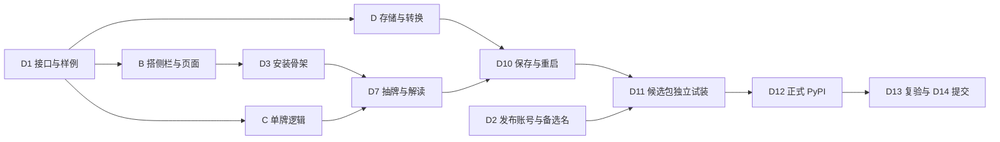

# Tarot JupyterLab 插件两周开发与 PyPI 发布计划

## 1. 项目目标

在两周内把一个可用的 JupyterLab 4 英文侧栏插件发布到**正式 PyPI**。在另一台电脑的干净 Python 环境中，按包名和版本安装后，用户可以完成以下流程。

1. 打开 JupyterLab 侧栏中的 **Tarot**。
2. 输入问题，点击 **Draw a card**，看到牌名、正逆位和对应关键词。
3. 点击 **Generate reading**，用课程提供的 Socrates 生成英文总结、单牌解读和建议。
4. 点击 **Save as latest**，保存问题、牌面和当前解读。
5. 重启 JupyterLab，打开 **Latest saved reading**，核对保存内容。

课程模型不可用时，用户仍可抽牌并保存牌面。团队用模拟模型测试成功、失败和超时。正式验收记录单独列出真实 Socrates 的验证结果。

### 1.1 当前起点

| ZIP 中的现状 | 两周计划中的用法 |
| --- | --- |
| `card_set.json` 已有 78 张牌和正逆位关键词。 | 直接打进 wheel，由后端读取。首版无需补做牌面图片或英文资料库。 |
| `models.py`、`errors.py` 和 `_version.py` 已有。 | 复用共享模型、异常类型和版本来源。 |
| `ai/` 已有提示词、解读解析器、`FakeAIProvider` 和 `SocratesProvider`。 | 保留现有调用接口，新增 Jupyter 请求层和失败恢复测试。 |
| `tests/unit/` 已有模型及 AI 测试。 | 先跑现有测试，再补抽牌、存储和安装主流程。 |
| `pyproject.toml` 已有 Hatch/Jupyter 构建配置。 | 补齐前端、服务端入口和启用配置。处理引用尚缺 Schema 的打包项，并以实际试装验证配置。 |

### 1.2 人力与验收时间

团队共 6 人，只有 A 和 B 有 Coding Agent。按 **A 全量、B 半量、C 与 D 各全量**计算必做产能，E 和 F 负责可独立验收的机动工作。假设全量成员两周各能投入 20–30 小时、B 能投入 10–15 小时，总计 **70–105 人时**。B 的前端任务需要在 D1–D5 集中安排约 8 小时，D1 就确认可用时段和接手人。

按低档 70 人时排，任务表预算 **A 19 小时、B 8 小时、C 17 小时、D 19 小时**，余约 7 人时处理联调和发布问题。工时是规划估算，D3 按实际完成量复核。若前端构建、干净环境试装或外部权限卡住，按第 10 节接手和上报。

D1 是开工日，D1–D14 为日历天，默认每天 **北京时间 20:00** 验收。D1 将代号替换为姓名、将 D1–D14 映射到实际日期，并核对课程要求的包名、版本、源码包和提交材料。正式 PyPI 上的 wheel 是本计划的最低发布范围。课程如要求 `sdist`，D1 将其加入打包任务、预发布验证和正式上传清单。

## 2. 首版范围

### 2.1 必做项

| 编号 | 功能 | 验收条件 |
| --- | --- | --- |
| P0-1 | 预构建英文侧栏与服务端 | 按 README 从 PyPI 安装一套已验证的 Python/JupyterLab 4 组合，侧栏可见并能在 Jupyter 认证开启时调用 API。安装者无需构建前端。 |
| P0-2 | 单牌抽取 | 去除问题两端空白后校验长度。服务端从 78 张牌抽一张，生成会话 ID，返回牌名、正逆位和关键词。每次成功抽牌创建新会话。 |
| P0-3 | 英文解读 | 使用现有适配器显示总结、逐牌解读和建议。显示英文娱乐及自我反思提示。演示前验证一次真实课程调用，并记录结果。 |
| P0-4 | 失败恢复 | 缺配置、连接失败、无效模型输出、超时均有英文提示。生成期间拒绝冲突操作。失败后仍可重试、保存牌面或新抽牌。 |
| P0-5 | 保存与重启查看 | 按钮明确说明只保存最近一条，替换前确认。可保存有解读或无解读的记录。重启后只读查看，内容一致。写入失败保留旧文件。 |
| P0-6 | 正式 PyPI 发布 | 公开项目页上有指定版本及 wheel。另一位同学在干净环境用 `pip` 从正式 PyPI 安装并完成验收，留下包链接、版本、命令和结果。 |

### 2.2 延后项

| 项目 | 首版边界 |
| --- | --- |
| 三牌阵、自定义牌阵、按位置重抽、重复抽牌设置 | 只实现 `single` 和 `focus`。用户可发起一次新的单牌抽取。 |
| 牌库浏览、搜索、背景资料、牌面图片和多语言界面 | 抽牌结果直接展示内置的英文牌名和关键词。 |
| 多条历史、分页、恢复编辑、导入和导出 | 保存一个本地快照，侧栏只读查看最近一条。 |
| 多用户、多活动会话、账号与同步、完整 JSON Schema | 针对单用户 JupyterLab，服务端保留一个活动会话，字段契约由共享样例验证。 |
| 自动发布、多平台矩阵和额外制品 | 手动发布，验证一套目标环境。`sdist` 按课程要求决定。 |

## 3. 目录和模块边界

以下路径用于分工，前端模板生成的文件名可在 D1 调整一次。各模块只在边界使用共享契约。

```text
card_set.json                              # 已有，唯一牌库数据源
pyproject.toml                             # A，构建、依赖和 wheel 安装映射
README.md                                  # C，面向安装者和阅卷人
src/tarot_jupyterlab/
  __init__.py                              # A，导出服务端扩展发现入口
  _version.py                              # 已有，A 更新发布版本
  models.py                                # 已有，共享 Python 模型
  errors.py                                # 已有，共享异常
  ai/                                      # 已有，C 验证，A 接入
  cards.py                                 # C，载入牌库、校验问题、创建单牌会话
  history.py                               # D，记录转换、原子保存、只读加载
  app.py                                   # A，注册请求及协调活动会话
  labextension/                            # 构建生成的前端产物
frontend/
  package.json                             # B 搭模板，A 核对输出和锁文件
  src/index.ts                             # B，插件注册和侧栏挂载
  src/sidebar.tsx                          # B，单页 UI 和按钮状态
  src/api.ts                               # B，集中请求与错误提示，A 接线
  src/types.ts                             # B，复用第 4 节字段定义
jupyter-config/jupyter_server_config.d/
  tarot_jupyterlab.json                    # A，启用服务端扩展
tests/
  fixtures/                                # A 提交共享响应样例，C、D 复用
  unit/test_cards.py                       # C
  unit/test_history.py                     # D
  integration/                             # A、C，最小请求与失败恢复检查
```

- `app.py` 负责请求校验、活动状态和调用顺序。抽牌算法由 `cards.py` 持有，历史格式由 `history.py` 持有。
- 现有 `Card`、`DrawnCard`、`Session`、`Reading`、`SessionRecord` 为 Python 数据来源。存储及 HTTP 共用 `record_to_dict`，前端仅声明对应 JSON 字段。
- `card_set.json` 在 wheel 内映射为包资源，安装后的读取基于 `importlib.resources`。构建前后都只维护仓库根部的源文件。
- 前端注册名、Jupyter 扩展目录名、Python 导入名及 PyPI 分发名分别核对。若 PyPI 名称被占用，先改分发名和安装命令，保留已通过测试的导入及扩展注册名。

## 4. 数据模型和接口契约

### 4.1 会话与记录

| 对象 | 字段和首版约定 |
| --- | --- |
| `Card` | 保留牌名、类别、花色、牌号、等级、元素和两组关键词。正逆位属于抽牌结果。 |
| `DrawnCard` | `card` 为实际抽到的牌，`position="focus"`，`orientation` 只能是 `upright` 或 `reversed`。 |
| `Session` | 服务端生成 UUID，`spread_name="single"`、`cards` 长度为 1、`revision=1`、`allow_repeats=false`。`created_at` 和 `updated_at` 是带时区的 UTC 时间。 |
| `Reading` | `session_id` 与 `session_revision` 必须匹配当前会话。含 `summary`、长度为 1 的 `card_interpretations`、`advice`、`provider` 和 `created_at`。 |
| `SessionRecord` | 顶层固定为 `schema_version=1`、`session`、`reading`。还未解读时 `reading=null`。 |
| 运行状态 | 活动记录、正在生成的请求及前端按钮状态只在运行时维护。解读成功可以更新时间，保存与查看保留快照原值。 |

一次抽牌同时完成新建会话和选牌，因此对外第一次看到的版本为 1。连续发起两个独立会话可以抽到同一张牌。`allow_repeats=false` 保留现有模型含义，首版没有会话内重复抽牌设置。

### 4.2 HTTP 请求与响应

下表路径相对于 Jupyter Server 的 `base_url`。后端用服务配置注册路径，前端从 `app.serviceManager.serverSettings` 取得 `baseUrl`，通过 `URLExt.join` 和 `ServerConnection.makeRequest` 请求。写请求使用 `application/json`。服务端校验请求体、类型和字段，牌面、版本和时间由服务端决定。 [JupyterLab 请求设计模式](https://jupyterlab.readthedocs.io/en/stable/developer/patterns.html#server-requests) · [Jupyter Server 扩展](https://jupyter-server.readthedocs.io/en/latest/developers/extensions.html)

| 方法和路径 | 请求 | 成功响应 | 约定 |
| --- | --- | --- | --- |
| `GET /tarot/api/health` | 无 | `200 {"status":"ok"}` | 验证服务端启用和前端通信，独立于 AI 配置。 |
| `POST /tarot/api/draw` | `{"question":"What should I reflect on?"}` | `200 {"record": SessionRecordJSON}` | 问题去两端空白后为 1–2000 字符；成功后替换内存中的活动记录，初始 `reading=null`。 |
| `POST /tarot/api/reading` | `{"session_id":"…","language":"en"}` | `200 {"record": SessionRecordJSON}` | 只处理当前 ID。首版接受 `en` 或省略该字段。已有解读时返回当前记录，失败后可重试。 |
| `POST /tarot/api/history/latest` | `{"session_id":"…"}` | `200 {"record": SessionRecordJSON}` | 保存服务端的完整活动记录，磁盘替换成功后才回复成功。 |
| `GET /tarot/api/history/latest` | 无 | `200 {"record": SessionRecordJSON 或 null}` | 文件不存在返回 `{"record":null}`，损坏时返回存储错误。查看历史不创建活动会话。 |

已保存的记录格式与 `record` 字段内容相同，磁盘 JSON 顶层没有 HTTP 的外层包装。时间以 ISO 8601 带时区字符串表示，Python 的 tuple 转为数组，`None` 转为 `null`。

### 4.3 TypeScript 类型与样例

`frontend/src/types.ts` 按以下字段声明。A 在 D1 交同一组 JSON 样例给 B、C 和 D，包括 `draw-ok.json`、`reading-ok.json`、`history-empty.json`、`reading-timeout.json`。

```typescript
export interface CardJSON {
  name: string;
  arcana: "Major" | "Minor";
  suit: "Wands" | "Cups" | "Swords" | "Pentacles" | null;
  number: number | null;
  rank: string | null;
  element: string;
  upright: string[];
  reversed: string[];
}

export interface DrawnCardJSON {
  card: CardJSON;
  position: "focus";
  orientation: "upright" | "reversed";
}

export interface SessionJSON {
  session_id: string;
  question: string;
  spread_name: "single";
  cards: [DrawnCardJSON];
  revision: 1;
  allow_repeats: false;
  created_at: string;
  updated_at: string;
}

export interface ReadingJSON {
  session_id: string;
  session_revision: 1;
  summary: string;
  card_interpretations: [string];
  advice: string;
  provider: string;
  created_at: string;
}

export interface SessionRecordJSON {
  schema_version: 1;
  session: SessionJSON;
  reading: ReadingJSON | null;
}

export interface ErrorJSON {
  error: { code: string; message: string };
}
```

下面是一条可用于解读、保存和读取测试的合成数据。抽牌成功样例使用相同的结构，将 `reading` 改为 `null`，并令 `updated_at` 等于 `created_at`。

```json
{
  "record": {
    "schema_version": 1,
    "session": {
      "session_id": "e3338dca-3a88-4a5f-8bb7-5b2dc96f1398",
      "question": "What should I reflect on?",
      "spread_name": "single",
      "cards": [
        {
          "position": "focus",
          "orientation": "upright",
          "card": {
            "name": "The Fool",
            "arcana": "Major",
            "suit": null,
            "number": 0,
            "rank": null,
            "element": "Air",
            "upright": ["beginnings", "freedom"],
            "reversed": ["recklessness", "hesitation"]
          }
        }
      ],
      "revision": 1,
      "allow_repeats": false,
      "created_at": "2026-01-01T08:00:00+00:00",
      "updated_at": "2026-01-01T08:00:02+00:00"
    },
    "reading": {
      "session_id": "e3338dca-3a88-4a5f-8bb7-5b2dc96f1398",
      "session_revision": 1,
      "summary": "Consider approaching the question with curiosity.",
      "card_interpretations": ["The Fool suggests openness to a new start."],
      "advice": "Pick one small step you can reflect on today.",
      "provider": "FakeAIProvider",
      "created_at": "2026-01-01T08:00:02+00:00"
    }
  }
}
```

历史为空时返回 `{"record":null}`。超时返回下方结构。前端按 `code` 选择英文提示，遇到未知错误统一提示重试。

```json
{
  "error": {
    "code": "AI_TIMEOUT",
    "message": "The reading took too long. Try again or save the card without a reading."
  }
}
```

### 4.4 错误映射

| HTTP | `error.code` | 何时返回 | 界面处理 |
| --- | --- | --- | --- |
| 400 | `INVALID_REQUEST` | JSON 无法解析，字段缺失、类型不合法或问题长度超限。 | 显示表单提示，保留输入。 |
| 404 | `SESSION_NOT_FOUND` | 操作需要活动会话，服务端内存中没有。 | 提示重新抽牌。 |
| 409 | `SESSION_CONFLICT` | 客户端 ID 与服务端活动 ID 不同。 | 提示牌面已更新，清除过期按钮状态，引导新抽牌。 |
| 409 | `READING_IN_PROGRESS` | 生成期间有第二次生成、抽牌或保存请求。 | 提示等待，历史仍可只读查看。 |
| 503 | `AI_UNAVAILABLE` | 课程配置缺失、鉴权失败或无法连接。 | 提示检查配置或保存现有牌面。 |
| 504 | `AI_TIMEOUT` | provider 或请求整体等待超时。 | 恢复可操作状态，允许重试。 |
| 502 | `AI_BAD_RESPONSE` | provider 调用失败或响应结构无法解析。 | 提示生成失败，保留牌面。 |
| 500 | `STORAGE_ERROR` | 读取的记录损坏或写盘失败。 | 显示失败提示，可重试。 |
| 500 | `INTERNAL_ERROR` | 牌库或其他服务端异常。 | 显示通用错误，日志仅记录排查所需信息。 |

Jupyter 自身的认证拒绝或会话过期可能产生非 JSON 响应，前端给出重新连接提示。应用响应和普通日志中不写入 API key、认证头、完整模型原文或用户问题。

## 5. 模块实现说明

### 5.1 牌库和单牌逻辑（C）

```python
from datetime import datetime
from pathlib import Path
from random import Random

from tarot_jupyterlab.models import Card, Session


def load_card_set(path: Path | None = None) -> tuple[Card, ...]:
    """Read the packaged deck or the explicit test file."""


def create_single_session(
    question: str,
    cards: tuple[Card, ...],
    *,
    rng: Random | None = None,
    now: datetime | None = None,
) -> Session:
    """Validate the question and draw one card and one orientation."""
```

1. 载入 UTF-8 JSON，检查 78 张、22 张 Major、56 张 Minor、牌名唯一、必要字段存在及正逆位关键词有效。无效牌库抛出 `InvalidCardSetError`。
2. 安装环境默认读包内资源。测试显式传入临时文件或仓库牌库路径。后端启动时加载一次。
3. 问题去首尾空白。空白、超长或无法抽牌时抛 `InvalidSessionError`。用同一个随机源决定牌和正逆位，测试可注入固定种子。
4. C 交成功样例、非法问题和牌库异常测试。用固定随机种子验证同样的牌和正逆位，UUID 和时间允许独立变化。

### 5.2 活动状态与服务端（A）

1. 在包入口声明 `_jupyter_server_extension_points()`，指向 `tarot_jupyterlab.app`。由 `_load_jupyter_server_extension(serverapp)` 注册认证开启的五个请求。构建时安装服务端启用 JSON。 [Jupyter Server 扩展发现](https://jupyter-server.readthedocs.io/en/latest/developers/extensions.html#making-an-extension-discoverable)
2. 服务端实例持有牌库、一个活动记录和当前解读请求标记。只有请求处理层可更新这些对象。浏览器刷新后可打开最近保存记录；服务重启清除未保存活动会话。
3. 抽牌通过 `create_single_session` 创建独立记录。成功后前端以新响应替换牌面和解读区，抽牌失败时保留原显示。
4. 生成前校验会话 ID 与进行中状态，然后对当前会话取快照，标记进行中，在线程中调用现有同步 `generate_reading`。设置有界的整体等待时间，首版默认 45 秒，测试可用更短时间。
5. 工作线程只返回候选解读。请求处理层仅在标记和活动 ID 仍匹配时接受结果，失败或取消后清理本次标记。超时线程即使晚于后续请求返回，也不能写入活动记录。重复点击的前端按钮与服务端冲突检查都要验证。
6. 保存时再次校验 ID，读取当前服务端记录并调用 D 的存储函数。加载历史为只读操作，期间可以查看最近保存的内容。

### 5.3 单页英文侧栏（B，D5 后 A 接线）

建议页面从上到下使用 **Tarot**、**Your question**、**Draw a card**、**Drawn card**、**Generate reading**、**Save as latest**、**Latest saved reading**。说明包含 `For entertainment and self-reflection only.`。输入与按钮都有英文标签，可用键盘操作。问题和解读按普通文本渲染。

| 状态 | 页面行为 |
| --- | --- |
| 初始 | 可抽牌和查看历史，尚无活动记录时禁用生成和保存。 |
| 抽牌成功 | 显示正逆位和对应关键词，显示 `Unsaved`，允许生成或直接保存。 |
| 正在生成 | 显示 `Generating reading…`，禁用抽牌、重复生成和保存。 |
| 生成成功 | 展示总结、单牌解释和建议，允许保存。 |
| 生成失败或超时 | 保留牌面，恢复按钮，展示错误与重试方式。 |
| 请求保存 | 提示 `This replaces any previously saved reading.`。确认后发送 ID，收到成功响应才显示 `Saved`。 |
| 历史 | 显示空状态、只读记录或读取错误。查看历史不会覆盖当前表单。 |

`api.ts` 集中处理请求，将成功响应中的 `record` 解包给 UI。B 可先用 D1 样例接 UI。

```typescript
export declare function fetchHealth(): Promise<{ status: "ok" }>;
export declare function drawCard(question: string): Promise<SessionRecordJSON>;
export declare function requestReading(sessionId: string): Promise<SessionRecordJSON>;
export declare function saveLatest(sessionId: string): Promise<SessionRecordJSON>;
export declare function fetchLatest(): Promise<SessionRecordJSON | null>;
```

D5 交单页源文件、模板构建命令、接口接线位置及一段走查记录，A 从此负责真实接口接入。

### 5.4 最近记录与原子保存（D）

```python
from pathlib import Path
from typing import Any

from tarot_jupyterlab.models import SessionRecord


def record_to_dict(record: SessionRecord) -> dict[str, Any]:
    """Convert the shared models to the agreed record JSON shape."""


def save_latest(record: SessionRecord, path: Path) -> None:
    """Write a complete record and atomically replace the previous file."""


def load_latest(path: Path) -> dict[str, Any] | None:
    """Return a validated snapshot, or None when no record was saved."""
```

1. 保存路径由服务端决定，默认放在当前用户的 Jupyter 数据目录下的 `tarot-jupyterlab/latest.json`。测试注入临时路径，客户端只传会话 ID。
2. 保存时验证一张牌、支持的版本和解读关联，再在目标目录写临时文件，关闭后原子替换。替换失败抛 `StorageError` 并清理临时文件，旧记录保持可读。
3. 加载时文件缺失返回空。无法解码、关键字段缺失或解读关联错位返回 `StorageError`。读取后仅返回经过基本校验的 JSON，不重新抽牌或调用 AI。
4. 测试覆盖含解读和无解读的往返、空目录、覆盖、损坏文件及替换失败。手工重启验收从保存后的文件读取同一条问题、牌面、正逆位和解读。

### 5.5 AI 复用和课程验证（C 验证，A 接入）

- 复用 `SocratesProvider`、`generate_reading` 和输出校验。部署文档说明 `SOCRATES_API_BASE`、`SOCRATES_API_KEY`、`SOCRATES_MODEL` 的用途，以课程提供的实际配置为准。
- D2 用合成问题试真实请求，记录成功、失败类别或所缺的课程权限。用户问题和必要牌面会发送到课程模型，界面和 README 用简短文字说明。
- 测试用 `FakeAIProvider` 模拟结构化输出、失败和延迟。测试样例和截图使用合成问题，凭证不提交到仓库、不放入 wheel，也不粘贴到聊天工具。
- 如果课程服务在演示时不可用，可以展示明确标为模拟的结果。正式验收记录保留真实服务的通过或阻塞状态。

## 6. 六人分工与任务验收

任务表中的工时含实现、必要自测和交接。`A-01` 等是任务编号，`D1` 等是日期。每个任务以可合并的提交、测试输出或试装记录为交付物。

### A · Coding Agent，全量（19 小时）

| 任务 | 工时 | 截止与依赖 | 验收证据 |
| --- | ---: | --- | --- |
| A-01 接口与样例 | 2 | D1，无 | 合并五个请求的约定和四份 JSON 样例。B、C、D 用同一份样例开始实现。 |
| A-02 可安装骨架 | 5 | D3，B-01 | 提交服务端发现、健康检查、前端产物和启用配置的打包映射。提供 wheel、构建命令和 D 的独立安装结果。 |
| A-03 抽牌与解读接线 | 4 | D7，B-03、C-02、D-02 的转换函数 | 英文侧栏调用真实抽牌接口。模拟解读成功、失败和超时都有可复现结果。 |
| A-04 保存接线与联调 | 4 | D10 18:00，A-03、D-02 | 保存与读取接口工作，写入失败不会报成功。向 D 交可用于重启验收的提交。 |
| A-05 构建候选包 | 4 | D11 12:00，D10 功能冻结 | 从冻结提交构建 wheel，交文件名、版本、提交哈希、SHA-256 和 `twine check` 结果。D13 如需补丁，由 A 更新版本并重建。 |

A 的备份是 C（Python 接口）和 D（按构建命令重跑）。若 D3 之前 A 无法继续，团队当天重估骨架进度和发布风险。

### B · Coding Agent，半量（8 小时）

| 任务 | 工时 | 截止与依赖 | 验收证据 |
| --- | ---: | --- | --- |
| B-01 注册侧栏 | 3 | D2，A-01 的路径约定 | 开发环境出现空 **Tarot** 侧栏。提交模板、锁文件、构建命令及产物位置。 |
| B-02 单页主流程 | 3 | D4，A-01、B-01 | 用样例演示输入、抽牌、解读、保存和只读历史。 |
| B-03 状态与交接 | 2 | D5，B-02 | 演示空历史、失败、超时和覆盖确认。合并代码，标注真实接口的接线位置和剩余问题。 |

B 在 D5 交接给 A。D2 若无可加载的侧栏，A 当晚直接接手模板和最简页面，C 按样例继续实现后端逻辑。

### C · 普通成员，全量（17 小时）

| 任务 | 工时 | 截止与依赖 | 验收证据 |
| --- | ---: | --- | --- |
| C-01 课程模型试通 | 2 | D2，课程地址、模型名和权限 | 用合成问题记录一次真实调用结果，或标明具体权限或连接阻塞。 |
| C-02 牌库和单牌 | 5 | D4，A-01、现有牌库 | 合并 `cards.py` 及单元测试。覆盖数量、牌名唯一、合法牌面、固定种子和非法问题。 |
| C-03 解读失败测试 | 4 | D7，A-03 的测试入口 | 提交模拟成功、失败和超时的运行命令及结果。D7 验证失败后按钮恢复，D9 与 D 验证仍可保存牌面。 |
| C-04 用户说明 | 3 | D10，A-04 | 提交 README，包含精确安装版本、启动、课程配置、只保留一条历史和常见问题。D12 补正式包链接。 |
| C-05 独立试装 | 3 | D11 收到候选包或 TestPyPI 链接后试装；D12 正式上传后复验 | 各做一次干净环境试装。交环境版本、安装命令、结果和缺陷记录。 |

A 可接手 C 的抽牌最小实现。C 担任 D 的发布备份。C 接手发布时，由 A 在另一个干净环境复验；账号和权限按第 9 节处理。

### D · 普通成员，全量（19 小时）

| 任务 | 工时 | 截止与依赖 | 验收证据 |
| --- | ---: | --- | --- |
| D-01 发布准备 | 2 | D2，无 | 确认正式和测试账号、凭证准备情况、候选包名、备选名及 C 的接手路径。任务记录只留状态。 |
| D-02 记录转换和存储 | 7 | D5，A-01 | 交 `history.py` 及测试。最迟 D4 把 `record_to_dict` 合并给 A，D5 完成保存、读取和失败分支。 |
| D-03 安装与重启验收 | 4 | D3 骨架、D10 完整流程，分别依赖 A-02 和 A-04 | D3 记录本地 wheel 的侧栏和健康检查。D10 记录保存后重启、读取、覆盖与写入失败的结果。 |
| D-04 试发和正式发布 | 4 | D11 收到 A-05 后试发；C-05 候选试装通过后，于 D12 16:00 前正式发布 | 交 TestPyPI 结果或本地预发布试装记录、正式版本页及上传版本。 |
| D-05 交付材料 | 2 | D14，C-05 正式试装 | 提交最终链接、版本、安装命令、对应源码和验收表。补丁发生时记录最终通过的版本。 |

A 可接手最小存取实现，C 可接手发布。D 的第一周兼顾存储和骨架验收，README 由 C 负责。

### E 与 F · 普通成员，机动

| 人员与任务 | 验收日 | 可核对成果 |
| --- | --- | --- |
| E-01 牌库或问题边界 | D2 | 至少两个用例，写清输入、预期结果和运行方式；C 决定是否合并到基础测试。 |
| E-02 英文文案走查 | D7 | 抽牌、生成、错误和历史状态各检查一遍，提供可复现问题或通过记录。 |
| F-01 安装说明试走 | D3 | 按骨架说明试装，记录环境版本和实际结果，必要时附截图。 |
| F-02 演示走查 | D12 | 按 README 走一次发布版，提供演示截图或短视频以及失败步骤。 |

E、F 的任务未交付时由 C 维持核心测试和试装标准，附加走查可以关闭。机动成员提前交付后可以接明确的小任务，合并前保留原负责人的验收条件。

## 7. 依赖与逐日排期



| 日期 | 当天推进 | 到点检查 |
| --- | --- | --- |
| D1 | A 提交请求与样例；B 选前端模板；C、D 对齐存储结构和 Python/JupyterLab 版本；D 查课程发布规则。 | 姓名和日期写入任务表，确定 B 早期时段。记录课程必交项、目标环境和接口冻结提交。 |
| D2 | B 打开空侧栏；C 试课程模型；D 准备账号；E 交边界样例。 | 空侧栏可加载。Socrates 和发布权限有明确状态。若前端缺席，A 当晚接手。 |
| D3 | A 交骨架 wheel；D 在干净环境验证；F 另走一遍说明。 | 安装后侧栏返回健康检查成功，保留认证，记录构建和安装命令。复核剩余工时。 |
| D4 | C 合并单牌逻辑；D 先交序列化；B 用样例展示主流程。 | A 可用真实抽牌与转换函数；B 的主页面能用样例操作。 |
| D5 | B 交接前端；D 交存储与测试；A 开始接真实请求。 | 前端源文件、构建说明、存储函数全部可合并。 |
| D6 | A 串起抽牌和模拟解读；C 注入失败和超时。 | 实际页面能发请求，错误可复现，记录剩余缺陷。 |
| D7 | A、C 联调解读；E 走查英文；条件允许时从侧栏验证真实 Socrates。 | 抽牌、模拟解读和失败恢复通过。真实模型单列结果。 |
| D8 | A 接保存和读取；C 开始写 README。 | 能保存一条有解读的记录；空历史有明确状态。 |
| D9 | D 测覆盖、重启、损坏和失败；A 修接线。 | 形成验收记录初稿，标出 D10 前要修的阻塞项。 |
| D10 | A 在 18:00 前交接集成版本；D 验收重启；C 补完整安装和配置说明。 | P0 功能流程通过后在 20:00 冻结功能，记录候选提交。 |
| D11 | A 12:00 前交 wheel；D 检查内容并试发；C 在干净环境试装。 | C 记录候选包主流程通过。若换包或版本，重新验收候选包。 |
| D12 | D 16:00 前正式上传；C 从 PyPI 验证；F 走查演示。 | 20:00 前取得项目页链接、指定版本和干净环境安装结果。 |
| D13 | A 修发布阻塞，D 视情况发布补丁，C 重跑安装和失败恢复。 | 更新最终可验收版本、命令和证据，保留遗留问题。 |
| D14 | D 汇总交付；全组核对课程要求和个人贡献。 | 提交正式 PyPI 链接、源码版本、安装命令与一页验收记录。 |

D3、D7、D10、D12 是团队验收点。未通过时先处理影响下一步的具体阻塞，任务表上标明责任人、复验时间和证据。

## 8. 测试和验收证据

### 8.1 最低检查清单

| 编号 | 检查 | 预期 | 负责 |
| --- | --- | --- | --- |
| T01 | 跑 ZIP 中已有模型和 AI 单元测试 | 现有接口行为保持，单元测试不依赖课程网络。 | C |
| T02 | 载入牌库、固定种子抽牌、空白与超长输入 | 78 张唯一牌。可复现相同牌与朝向，拒绝非法输入。 | C |
| T03 | 在独立环境装骨架 wheel | 前后端扩展被发现，认证开启时健康检查成功。 | D |
| T04 | 发送单牌抽取，查看英文结果 | 一张牌、正确位置和关键词，活动 ID 发生变化。 | A |
| T05 | 生成模拟解读，检查成功和失败路径 | 解读关联当前牌。失败和超时后按钮恢复，可以保存牌面。 | A、C |
| T06 | 生成期间重复请求，再让模拟 provider 延迟返回 | 冲突请求被拒绝；超时后的迟到结果不写入活动记录。 | A、C |
| T07 | 在临时目录保存有解读和无解读的记录 | JSON 往返值相同；空目录和损坏文件有不同结果。 | D |
| T08 | 模拟写入或替换失败；随后重启查看 | 上一条已保存文件仍可读，页面不显示本次保存成功。 | D |
| T09 | 从侧栏发起真实 Socrates 调用 | 使用课程配置生成一份英文结果，证据中隐去凭证。 | C |
| T10 | 从正式 PyPI 安装指定版本并按 README 操作 | 无源码目录和手工前端构建，侧栏和完整流程可用。 | C |

已有测试与新增 Python 测试统一通过 `python -m pytest` 运行。D1 在开发说明写清依赖安装命令，D11 从冻结提交重跑一遍。T03、T09、T10 各有实际运行证据；模拟测试和正式环境检查分别记录。

### 8.2 手工验收顺序

1. 在干净环境安装指定版本，确认 JupyterLab 版本和插件可见。首次打开历史显示空状态。预发布和正式试装使用隔离的历史目录或测试用户。
2. 先提交空白问题，再提交合成问题。确认牌面来自返回记录、关键词对应正逆位。用测试模式复现一次解读失败或超时。
3. 用课程配置完成一次解读。确认总结、单牌解释和建议齐全，界面显示英文娱乐提示。
4. 保存记录。退出并重启 JupyterLab，打开历史，核对问题、牌名、正逆位、关键词和解读。
5. 在测试环境再保存一条无解读记录，检查替换确认和只显示最近一条。写入失败分支由 T08 验证。

### 8.3 验收记录格式

```text
检查项 / 日期与验收人：
环境（OS、Python、JupyterLab）：
源码提交、包名、版本、安装来源：
执行命令和主要步骤：
结果（通过 / 失败 / 阻塞）：
证据（测试输出、截图或公开版本链接）：
失败时的复现步骤、接手人、复验时间：
```

## 9. 构建、试发和正式发布

### 9.1 D1–D3 发布准备与骨架

- D1 确认课程是否指定 PyPI 分发名、版本、作者字段、源码包或截图。暂用 `tarot-jupyterlab` 作为候选，另选带组名的备选名。搜不到公开项目页时，仍要以正式上传结果确认名称。 [PyPI 包名规则](https://docs.pypi.org/project-management/choosing-a-name/)
- D2 由 D 和 C 各自验证邮箱、配置双重认证、确认可用权限。D 准备正式 PyPI 与 TestPyPI 的独立上传凭证。新项目由主发布人首次创建。需要交接时，尚未创建的项目由备份人按团队安排首发，已存在的项目由有权限的成员邀请备份人。 [PyPI 发布说明](https://docs.pypi.org/publishing/publishing-to-pypi/) · [PyPI 协作者管理](https://docs.pypi.org/project-management/managing-collaborators/)
- A、B 在 D3 前固定开发端的 Node、前端包管理器与锁文件。构建说明写明前端命令和输出位置。轮到 D 独立试装时，只使用 Python 和已构建的 wheel。
- A 检查 wheel 中有 Python 模块、牌库资源、预构建前端、服务端启用配置和元数据。扩展发现目录和前端插件名保持一致。运行时直接导入的第三方库写入项目依赖。
- `pyproject.toml` 的构建 hook 和前端构建脚本要相互匹配。从干净源码生成产物，避免使用未清理的旧前端。首版延期独立 Schema 时，移除指向缺失 Schema 的强制收录项。

### 9.2 D11 候选包与预发布验收

1. A 在干净构建目录从 D10 冻结提交构建，锁定测试过的工具版本。下方命令在开发环境执行，尖括号内替换为实际文件或值。

   ```bash
   python -m build --wheel --outdir dist/release
   python -m twine check "<wheel-path>"
   ```

2. A 记录提交哈希、版本、wheel 文件名与 SHA-256。D 检查 `README.md`、`LICENSE`、包元数据及文件列表，确认没有凭证、个人历史或测试用户数据。C 执行 T01–T02，随后独立试装候选包。
3. 优先由 D 上传本次候选 wheel 到 TestPyPI。C 在干净环境先从正式 PyPI 安装 JupyterLab 及项目所需依赖，再从 TestPyPI 安装明确版本。按第 8 节走主流程。 [Python Packaging User Guide](https://packaging.python.org/en/latest/tutorials/packaging-projects/)

   ```bash
   python -m twine upload --repository testpypi "<wheel-path>"
   python -m pip install --index-url https://pypi.org/simple/ "jupyterlab==<lab-version>"
   python -m pip install --index-url https://test.pypi.org/simple/ --no-deps "<package>==<version>"
   python -m pip check
   ```

   TestPyPI 暂不可用时，C 用相同 wheel 在干净环境试装，记录原因和本地验证结果。正式发布前必须有一次独立试装通过。改了候选文件、包名或版本时，重新构建、检查并试装。若同名制品已上传到所用索引，更新版本再上传。 [PyPI 上传故障排查](https://docs.pypi.org/publishing/troubleshooting/)

### 9.3 D12 正式发布与干净环境验证

1. D 核对 C 的通过记录、wheel 哈希、正式包名和版本，上传已试装的文件。课程要求源码包时同时按已验收的文件清单上传。上传凭证留在发布者本机，团队任务表只记录账号准备状态和结果。

   ```bash
   python -m twine upload --repository pypi "<wheel-path>"
   ```

2. D 记录正式版本页链接、上传时间、包名与版本。C 创建另一个干净环境，激活该环境或显式使用其 Python，再执行正式安装。命令中锁定已验证的 JupyterLab 4 版本，避免复验时拉到不同组合。

   ```bash
   python -m pip install --index-url https://pypi.org/simple/ --no-cache-dir "jupyterlab==<lab-version>" "<package>==<version>"
   python -m pip check
   jupyter labextension list
   jupyter server extension list
   jupyter lab
   ```

3. C 检查两类扩展都能发现和启用，在侧栏跑完整流程，留存对应版本和脱敏截图。正式安装命令只使用 PyPI 的指定包名和版本。

### 9.4 D13–D14 修复与提交

- 正式发布后发现功能或安装缺陷时，A 修复并提升补丁版本，D 对新制品重走检查和上传，C 从正式 PyPI 再试装。验收表和 README 使用最后通过的版本。 [PyPI 上传故障排查](https://docs.pypi.org/publishing/troubleshooting/)
- D14 交付正式 PyPI 版本页、实际安装命令、源码提交或标签、README、验收表和个人贡献记录。保留对已知阻塞的简短说明。

## 10. 缺席、延期和贡献记录

### 10.1 任务管理

- D1 将第 6 节任务放进共享任务表。每项有负责人、验收人、接手人、截止时间和可验证结果。
- 每人到自己的验收日提交证据。未完成时，留下最近可运行的提交、复现命令、差缺、剩余工时和建议下一步。口头进度只作为补充。
- 全员可用豆包、DeepSeek 等工具辅助。两位有 Coding Agent 的同学优先将工具时间用于骨架、请求接线和构建排错。提交者需要能解释并运行改动。共享给工具的样例使用合成问题和脱敏日志。
- 原作者的已合并贡献与接手人的完成部分分别记录。期末按合并内容、有效测试、试装和发布证据填写。

任务记录可用以下格式。

```text
任务编号 | 负责人 | 验收人 | 接手人 | 截止
状态：未开始 / 进行中 / 待验收 / 通过 / 阻塞 / 已交接
交付：提交或 PR、运行命令、验收证据
阻塞：复现步骤、剩余工作、接手后的下一步
```

### 10.2 接手触发条件

| 触发 | 当天怎么处理 |
| --- | --- |
| B 在 D2 验收时交不出可加载侧栏 | A 当晚接手官方模板和最简页面。C 和 D 继续按样例独立开发。B 可在可用时段补样例和交接。 |
| D3 骨架装上后没有侧栏、服务端未启用或请求失败 | 先查 wheel 内容，再查扩展发现与启用，最后查 `base_url` 和认证。A、B 在 D4 集中修复，D 用同一命令复验。D5 仍失败时当天报告具体风险。 |
| C 的抽牌或 D 的存储没按时交 | A 取得当前分支，优先补能接入的最小实现。测试和复验按第 6 节交接，E/F 的附加项可以取消。 |
| Socrates 权限或网络阻塞 | C 保留脱敏复现，尽早向课程方确认地址、模型和权限。模拟模型继续承担联调。真实调用在验收表单列，课程要求的结果以实际验证为准。 |
| D 无法发布、包名被拒或正式上传失败 | C 接手已获授权的发布；包名被拒时切备选名，同步元数据和 README，重新构建和试装。D13 优先保留给正式发布补救。 |
| 核心成员连续错过两个验收点或明确无法继续 | 当天更新剩余人力和任务表，关闭延期项。若必做流程仍会延期，尽早向老师说明受影响的验收项。正式 PyPI 是项目要求。 |

## 11. 最终完成标准

- [ ] 正式 PyPI 有可访问的项目页、指定版本和正确的 wheel。
- [ ] 独立同学用 README 在干净环境从正式 PyPI 安装，前端扩展和后端均启用。
- [ ] 英文侧栏可抽出单牌，正逆位、关键词和解读正确对应。
- [ ] 真实 Socrates 调用已有证据，模拟失败和超时后可以继续操作。
- [ ] 最近记录含牌面及已有解读，重启后可查看，覆盖提示与写入失败处理均已验证。
- [ ] 核心测试、构建与包内容检查通过，包内未发现凭证或私人记录。
- [ ] D14 提交的是最后通过的 PyPI 版本、安装命令、对应源码、验收结果和六人的实际贡献。
