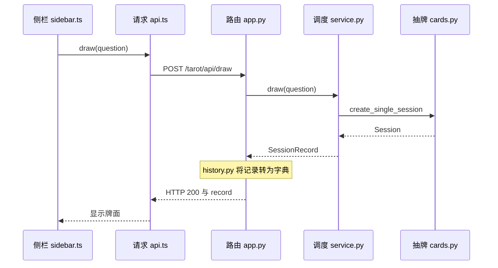

# 抽牌请求代码讲解与浏览器验证

这份讲解对应 `tarot-jupyterlab-scaffold.zip` 中的源码和 `0.1.0` 演示安装包。把源码 ZIP 解压后，用 VS Code 打开里面的项目文件夹。浏览器保留 JupyterLab 页面，方便一边点按钮，一边找对应代码。

## 先把演示版打开

如果你已经在 JupyterLab 左边看到了竖着写的 **Tarot**，可以直接去下一节。它在列表图标和拼图图标之间。

Windows 上，把 `tarot_jupyterlab-0.1.0-py3-none-any.whl` 放进一个文件夹。在文件资源管理器打开这个文件夹，在地址栏输入 `cmd` 并回车。在同一个窗口里逐行执行下列命令。

```cmd
python -m venv .venv
.\.venv\Scripts\python.exe -m pip install "jupyterlab==4.6.5" ".\tarot_jupyterlab-0.1.0-py3-none-any.whl"
set "TAROT_DEMO_MODE=1"
.\.venv\Scripts\python.exe -m jupyterlab
```

浏览器打开后，点击 **Tarot**。这个模式用模拟 AI，可以直接跑解读。

### 三个实际遇到的问题

- **VS Code 双击 wheel 时提示二进制文件。** `.whl` 是 Python 安装包，用上面的命令安装。要看或改代码，解压源码 ZIP 后用 **文件 → 打开文件夹**。
- **复制了文件名，终端找不到文件。** `.\` 表示当前目录。请在存放 wheel 的文件夹里开终端，复制完整安装命令。
- **设置模拟模式时报「文件名、目录名或卷标语法不正确」。** CMD 用 `set "TAROT_DEMO_MODE=1"`。终端提示符开头有 `PS` 时，用 PowerShell 的 `$env:TAROT_DEMO_MODE = "1"`。设置后在同一窗口启动 JupyterLab。

## 一次抽牌经过哪些文件



### 1. `index.ts` 注册侧栏，`sidebar.ts` 响应点击

JupyterLab 启动时，`frontend/src/index.ts` 创建 `TarotClient` 和 `TarotSidebar`，用 `app.shell.add(sidebar, 'left', …)` 把它放到左边。

然后打开 `frontend/src/sidebar.ts`，搜索 `addEventListener('submit'`。**Draw a card** 是表单的提交按钮，点它时会进入这段代码。下面摘出两行。

```typescript
event.preventDefault();
this.setActive(await this.client.draw(this.question.value));
```

- `this.question.value` 是输入框里的文字。
- `event.preventDefault()` 让我们接管表单提交，保留当前页面。
- `await` 表示等抽牌请求返回，再把结果交给 `setActive()`。外层的 `run()` 在等待时禁用按钮，遇到错误会把提示显示到侧栏。

### 2. `api.ts` 把问题变成 HTTP 请求

打开 `frontend/src/api.ts`，搜索 `async draw`。

```typescript
const result = await this.request<RecordResponse>('draw', { question });
return result.record;
```

这里把问题放进 `{ question }`。共用的 `request()` 读取 JupyterLab 的服务器地址，用 `URLExt.join()` 拼接路径，再用 `JSON.stringify()` 把数据转成 JSON，通过 `ServerConnection.makeRequest()` 发出请求。

以本机 JupyterLab 的 8888 端口为例，请求大致长这样。

```http
POST http://localhost:8888/tarot/api/draw
Content-Type: application/json

{"question":"What should I reflect on today?"}
```

浏览器这时把问题发给后端。牌面和正逆位等后端返回。

### 3. `app.py` 接收请求，调用调度层

打开 `src/tarot_jupyterlab/app.py`，搜索 `DrawHandler`。服务启动时已经把 `draw` 路径登记给这个类。收到 POST 请求后，它读取 JSON，检查 `question` 是否存在且为字符串，然后执行这行。

```python
self.finish({"record": record_to_dict(self.service.draw(question))})
```

从里面往外读。先调用 `self.service.draw(question)`，再用 `record_to_dict()` 转换结果，最后由 `self.finish()` 把结果放在 `record` 字段里返回。格式错误会通过同文件中的错误映射返回给浏览器。

### 4. `service.py` 记住当前会话，`cards.py` 选牌

打开 `src/tarot_jupyterlab/service.py`，搜索 `def draw`。

```python
self._require_idle()
self._active = SessionRecord(create_single_session(question, self._cards))
return self._active
```

调度层先确认当前没有在生成解读，再调用 `cards.py` 里的 `create_single_session()`。这个函数去掉问题首尾空白、检查长度，从牌库随机选一张牌，再随机决定正位或逆位。它也用 `uuid4()` 给这次抽牌生成一个新的 `session_id`。

`models.py` 定义了 `Session` 和 `SessionRecord` 的字段。调度层把会话包成一条记录，放在 `self._active`。稍后生成解读或保存时，后端会检查前端传来的 `session_id` 是否仍对应当前记录。

### 5. `history.py` 转换数据，`sidebar.ts` 把牌画出来

`history.py` 里的 `record_to_dict()` 把 Python 数据整理成适合 JSON 的结构。例如时间变成字符串，没生成解读时 Python 的 `None` 最终在浏览器里显示为 `null`。这个转换函数同时供接口和保存使用。实际写盘发生在点击 **Save as latest** 并确认后。

浏览器收到响应后，`api.ts` 取出 `record`，交回等待中的侧栏。`sidebar.ts` 的 `renderRecord()` 从 `session.cards[0]` 取出第一张牌，显示牌名和朝向。`card[orientation]` 表示按朝向选关键词，例如 `orientation` 是 `upright` 时读取 `card.upright`。

## 在浏览器里亲手验证

### 练习一 · 看一次成功的抽牌

1. 在 JupyterLab 按 `F12`，打开 **Network（网络）**，选 **Fetch/XHR**。先打开网络面板，再点抽牌。
2. 在 Tarot 输入 `What should I reflect on today?`，点 **Draw a card**。点击请求列表里新出现的 `draw`。
3. 在 **Headers（标头）** 里确认方法是 `POST`，状态码是 `200`。在 **Payload（载荷）** 里核对 `question` 和你刚输入的文字。
4. 在 **Preview（预览）** 或 **Response（响应）** 里展开 `record → session → cards → 0`。对比 `card.name`、`orientation` 和侧栏显示。再看 `record.reading`，此时应该是 `null`。

### 练习二 · 看抽牌编号怎么传下去

1. 在 `draw` 的响应里找到 `record.session.session_id`，记下末尾几位。
2. 点 **Generate reading**，点击新的 `reading` 请求，在 **Payload** 里找 `session_id`。它应该和刚才看到的是同一个。
3. 再看 `reading` 的 **Response**。成功时，`record.reading` 里会出现总结、建议和提供者。模拟模式下提供者是 `FakeAIProvider`，侧栏会标注 **Demo reading (simulated)**。
4. 点 **Save as latest** 并确认。回到启动窗口按 `Ctrl+C`，再执行启动 JupyterLab 的那一行。重新打开 **Tarot → View latest**，核对问题、牌面和解读。

### 练习三 · 看一条失败请求

在问题框里**只输入几个空格**，再点 **Draw a card**。打开新出现的 `draw`，它应该返回 `400`，在响应里看到 `error.code = INVALID_REQUEST`，侧栏也会显示提示。

对照源码可以看到错误走了三个地方。`cards.py` 用 `strip()` 去掉空格后发现问题是空的。`app.py` 把这个错误转换成 HTTP `400`。`sidebar.ts` 接到失败后显示提示，让你可以修改问题再试。

## 读完以后可以做的小练习

先在 VS Code 找到 `Card drawn. Unsaved.` 这一句，说明它为什么出现在 `await` 后面。然后给同伴演示一次 `200` 和一次 `400`，试着用自己的话回答三个问题。

1. 点击按钮后，哪个文件把输入发给后端？
2. 谁决定抽到哪张牌，以及它是正位还是逆位？
3. 为什么点生成解读时要传回刚才的 `session_id`？

要分工继续开发时，前端从 `frontend/src` 开始，Python 后端从 `src/tarot_jupyterlab` 开始。源码中的 `docs/learning.md` 还有各技术的参考资料。
