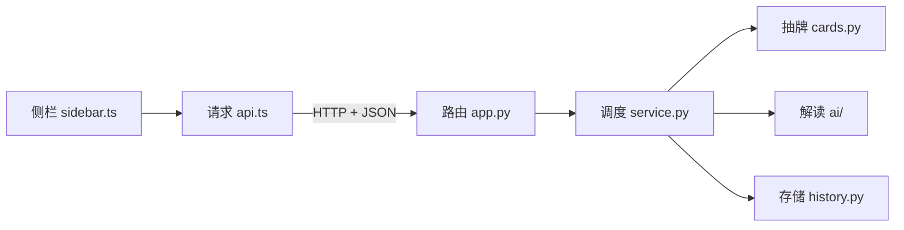

# 接口与技术学习指南

先运行 README 的模拟演示，再选一个请求顺着代码读。建议从 **Draw a card** 开始，因为它会走完前端、HTTP、后端调度和领域逻辑。

## 1. 请求怎么走

1. `sidebar.ts` 的表单读取问题，调用 `TarotClient.draw(question)`。
2. `api.ts` 用 JupyterLab 的 `ServerConnection` 发请求。URL 从 JupyterLab 配置的 `baseUrl` 开始拼接。认证和请求防护沿用 Jupyter 的机制。
3. `app.py` 中的 `DrawHandler.post` 验证 JSON，再调用 `TarotService.draw`。这里也把业务异常转换为统一的 HTTP 状态和错误对象。
4. `service.py` 调用 `cards.py` 新建单牌会话，并保留活动记录。解读和保存拿着返回的 `session_id` 继续操作。
5. `history.py` 的 `record_to_dict` 转换现有 Python 数据模型。前端收到 `record` 后，显示牌名、朝向和对应关键词。

## 2. 五个请求

路径都相对于 Jupyter Server 的 `base_url`。POST 使用 JSON 请求体。成功返回 HTTP 200。

| 请求 | 请求体 | 响应 |
| --- | --- | --- |
| `GET /tarot/api/health` | 无 | `{"status":"ok"}` |
| `POST /tarot/api/draw` | `{"question":"What should I reflect on?"}` | `{"record": …}`，此时 `reading` 为 `null` |
| `POST /tarot/api/reading` | `{"session_id":"…","language":"en"}` | `{"record": …}`，含已验证的解读 |
| `POST /tarot/api/history/latest` | `{"session_id":"…"}` | `{"record": …}`，保存成功的记录 |
| `GET /tarot/api/history/latest` | 无 | `{"record": …}` 或 `{"record":null}` |

抽牌后，打开浏览器开发者工具的 **Network**，找 `draw`。比较请求体和响应里的 `record.session.session_id`。再查看 `reading`，确认它使用同一个 ID。计划文档中有完整的成功响应和超时 JSON 样例。

## 3. 这些技术各负责什么

| 技术 | 本项目怎么用 | 从哪学起 |
| --- | --- | --- |
| TypeScript 与 Lumino | 给侧栏和接口响应加类型，使用 JupyterLab 自带的 Widget 系统注册面板。 | 读 `types.ts` 和 `index.ts`，再改一个按钮标签。 [JupyterLab 扩展教程](https://jupyterlab.readthedocs.io/en/stable/extension/extension_tutorial.html) |
| HTTP 与 JSON | 浏览器向 Python 服务发送问题和 ID，后端用同一响应结构返回记录。 | 在 Network 面板观察状态码、请求和响应。 [JupyterLab 请求示例](https://jupyterlab.readthedocs.io/en/stable/developer/patterns.html#server-requests) |
| Jupyter Server 与 Tornado | 注册认证保护的 GET/POST 路由，验证输入并调用服务。 | 对照 `HealthHandler` 和 `DrawHandler`。 [Jupyter Server 扩展文档](https://jupyter-server.readthedocs.io/en/latest/developers/extensions.html) |
| Python dataclass 与 asyncio | 用 dataclass 表示牌面、会话和解读。用 `asyncio.to_thread` 在工作线程等待同步模型，超时由调度层统一处理。 | 对照 `models.py` 和 `TarotService.read`，分清哪个地方计算结果、哪个地方接受结果。 [asyncio 任务与线程](https://docs.python.org/3/library/asyncio-task.html#asyncio.to_thread) |
| JSON 文件与原子替换 | 先写完同目录的临时文件，再替换最近记录。读历史不重新抽牌或调模型。 | 给 `test_failed_replacement_preserves_the_saved_record` 加断点，看旧文件为何仍在。 |
| Hatch、Jupyter Builder 与 wheel | 构建 TypeScript 后，把 Python、前端产物、牌库和启用配置放进同一 wheel。 | 读 `pyproject.toml` 的 `shared-data`、`force-include` 和构建 hook。 [Python 打包指南](https://packaging.python.org/en/latest/tutorials/packaging-projects/) |

## 4. 组员可以从哪些改动开始

- **A** 在 `app.py` 和 `service.py` 检查输入、错误码与状态变化。先演练用过期 ID 保存，确认得到 409。
- **B** 在 `sidebar.ts` 调整加载、空历史和英文提示。在 `api.ts` 保持所有请求从同一个客户端发出。
- **C** 用固定随机种子核对抽牌，跑现有 AI 测试，再用课程配置和合成问题验证真实模型。
- **D** 在 `history.py` 和测试中练习保存、覆盖、损坏文件与重启恢复。按计划用干净环境验收 wheel。
- **E** 用空白问题、超长问题、非文本输入和无效会话 ID 做边界走查，提交输入、预期状态和结果。
- **F** 用 README 在另一环境走一遍安装，记录版本、步骤和第一处不能继续的地方。

调度层当前按单用户、一个活动会话设计。工作线程只拿会话副本、只返回解读，避免迟到结果直接修改页面对应的记录。正式发布前还需要验证课程 Socrates、备选包名和 PyPI 上传流程。
